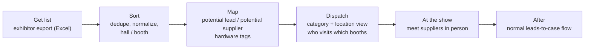

# Exhibition Mapping — plan

**Status: planning only — nothing built.** Do not build, deploy, or contact anyone outside the team.

Separate from [LEADS_PLAN.md](LEADS_PLAN.md), and follows the same principles. First use: electronica 2026 (Munich), 3,665 exhibitors.

---

## 1. What this is

Before a show, import the exhibitor list and map every exhibitor into **potential leads** (companies we could sell to) and **potential suppliers** (companies we could buy from). A company can be both.

There are too many booths to visit them all. So employees get a **category-and-location view**: which suppliers of which hardware are in which hall and booth. That lets us dispatch people on the floor to meet the right suppliers in person. Follow-up after the show goes through the normal leads-to-case flow; this plan adds nothing new there.

Reusable for every future exhibition: **get list → sort → map → dispatch.**

Once the exhibition is mapped in the lead pipeline dashboard UI, it is viewed in a **separate exhibition knowledge base with its own UI**, distinct from the existing leads knowledge base UI. At this stage the exhibition mapping needs no MCPs, no cases, and no connection to any other system; it is self-contained.



---

## 2. Principles

- **No migrations to dbot-db** and no changes to the loop's schema.
- **No extensions, triggers, or LISTEN/NOTIFY.**
- **Access:** the same Entra app and `leads-auth` pattern. Own redirect URL for `leads.dayo-tech.com` and own token, separate from the Temporal auth and the other apps' auth. `leads-auth` is the only entry point to the app's port.
- **Excel is import and export only**, never the store.
- **Self-contained at this stage:** no connections to cases, SAP, MCPs, or any other external system. The exhibition view is its own knowledge base and UI, separate from the dashboard's other systems.

---

## 3. Steps

### 3.1 Get list

- **We create the Excel file and fill it in ourselves** for each show (for electronica 2026: Company, Country, City, Address, Phone, Primary email, Website, Hall/Booth, Categories, Description, Profile URL).
- **The database is then loaded from that Excel.** Loading creates or updates companies and one convention appearance per company for this show. Hall and booth live on the appearance, because they change between shows.
- We can keep filling in or correcting the Excel and load it again. Reloading is safe: it updates only the fields that come from the Excel and never overwrites tags, assignments or notes made in the app.

### 3.2 Sort

- Dedupe companies across shows (domain first, then normalized name; manual merge for groups).
- Split Hall/Booth into `hall` and `booth` so the view can group by hall.
- Keep the organizer's categories as they came (raw), for reference.

### 3.3 Map

Each company appearance gets:

- **Role:** `lead`, `supplier`, `both` or `ignore`, per show (a company can be a lead at one show and a supplier at the next). The company-level kind in the leads view is derived from these roles.
- **Hardware tags** (for suppliers): as many hardware categories as possible, drawn from each show's own site data, then grouped (for example RAM, GPU, disks, internal parts) so the groups can be used as filters. The list is not fixed upfront; it is decided per show.
- **Location:** hall and booth, from the import.
- **Priority:** must-visit, nice-to-visit, or skip.

Mapping starts with a suggestion from the organizer's categories and description (simple keyword rules, e.g. "memory / DRAM" → `RAM`). A person confirms or corrects it. Nothing counts as mapped until a person confirms.

### 3.4 Dispatch

- **Category-and-location view:** filter by hardware tag and role, grouped by hall, sorted by booth. Shows company, booth, tags, priority, and who is assigned.
- **Coverage map:** we are few people, so who goes to which hall matters less than seeing which halls, rooms and booths have been visited and which have not. The coverage view shows covered versus uncovered. If the exhibition provides a venue map, use it; if not, render coverage as an interactive hierarchy (floors → halls/rooms → booths → companies/suppliers) with React Flow or a similar free diagram library, rather than only a flat list.
- **Assign** booths to people optionally (for electronica 2026: Vartan, Yossi). Each person can get a floor list for their categories.
- **Export** the floor list to Excel or print for use on the floor.
- At the show: mark a booth visited, add a short note and contact. The floor list has two actions: **note** saves a short meeting (dated, markdown, stored in the app database) and **follow** creates a lead on the Leads board. Obsidian is an export only.

### 3.5 After the show

- Suppliers met in person and worth pursuing, and potential leads, are followed up through the normal leads-to-case flow from LEADS_PLAN.md. This plan does not create cases or touch SAP.

---

## 4. Data (in the app's own database)

Lives in the app's own Postgres (`leads-db`, its own external volume; not dbot-db). Reuses `conventions`, `companies`, `convention_appearances` (which carries `hall`, `booth`, `role` and `priority`), `contacts`, `import_batches` and `meetings` from the leads plan. Adds:

- **`hardware_tags`** `(id, name)` — the controlled list (RAM, GPU, disks, internal_parts, …).
- **`tag_groups`** `(id, convention_id, name)`, and `hardware_tags.group_id`, so groups work as filters per show.
- **`appearance_mapping`** `(appearance_id, suggested_role, confirmed_by, confirmed_at)`: the confirmation record; the confirmed `role` and `priority` sit on the appearance.
- **`venue_nodes`** `(id, convention_id, parent_id, kind, label, x, y)`: floor → hall/room → booth for the coverage diagram (see UI_PLAN.md).
- **`appearance_tags`** `(appearance_id, tag_id, suggested, confirmed)`.
- **`dispatch_assignments`** `(appearance_id, assignee, visited, visited_at, note)`.

Search uses plain `ILIKE` and Postgres built-in full text with the `simple` config. No extensions.

---

## 5. Screens

**App hierarchy.** The lead pipeline dashboard is one app (a single SPA). Inside it, **leads** is one route with its own screens and UI, and **exhibitions** is a separate route, its own section of the same app. The three screens below all live inside the exhibitions route.

```
lead pipeline dashboard (one app)
├── /leads         leads screens and UI
└── /exhibitions   exhibition mapping
    ├── map
    ├── dispatch
    └── floor list
```

- **Map:** the exhibitor table with role, tag and priority columns, suggested values highlighted until confirmed, bulk edit.
- **Dispatch:** hall-by-hall view, filters by hardware tag, role, priority and assignee; assign and export the floor list.
- **Floor list:** a phone-friendly list per person with visited and note fields.

---

## 6. Questions and answers

**Q1. What is the final hardware tag list beyond RAM, GPU, disks and internal parts?**
A: It is not a fixed set decided upfront. Each exhibition has its own categories from its website data, and we want as many categories as possible, grouped on top of the raw tags. The final list is decided after going through each show's information.

**Q2. Who maps: one person, or split by hall or category?**
A: Open.

**Q3. Who goes to which halls at electronica 2026, and on which days?**
A: Not important: we are few people. What matters is a coverage map of halls, rooms and booths visited versus not (see 3.4).

**Q4. Do we need a hall map image, or is the hall-and-booth list enough?**
A: If the exhibition provides a map, use it. If not, we build our own interactive UI, likely with React Flow or a similar free diagram library, as a hierarchy of floors, rooms, booths, suppliers and companies, showing covered versus uncovered.

**Q5. Does the floor list need to work offline?**
A: Open.

**Q6. Where do visit notes go long-term: the app, Obsidian, or both (link only)?**
A: The app database. A visit note is a short meeting; Obsidian is an export only.

---

## 7. Build order (only when Vartan says to build)

Priority: complete data and durable storage first, polished UI later.

1. **Get all the data.** For each exhibition, fill the Excel files we create from the exhibition's website: exhibitor data, categories, and a venue map if one exists. If there is no map, plan the React Flow fallback.
2. **Backend and frontend ready for intake.** The backend and a basic frontend for viewing this data are in place before any polished UI.
3. **Load the Excel data into the database.** The schema and the containers that hold it are already deployed, with storage on persistent volumes, so a redeploy never loses databases that are already filled. The app has its own database container (`leads-db`) on external named volumes (`leads-pgdata`, `leads-files`), so `docker compose down` and `up` keep all data.
