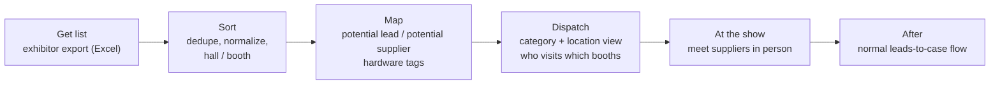

# Exhibition Mapping — plan

**Status: planning only — nothing built.** Do not build, deploy, or contact anyone outside the team.

Separate from [LEADS_PLAN.md](LEADS_PLAN.md), and follows the same principles. First use: electronica 2026 (Munich), 3,665 exhibitors.

---

## 1. What this is

Before a show, import the exhibitor list and map every exhibitor into **potential leads** (companies we could sell to) and **potential suppliers** (companies we could buy from). A company can be both.

There are too many booths to visit them all. So employees get a **category-and-location view**: which suppliers of which hardware are in which hall and booth. That lets us dispatch people on the floor to meet the right suppliers in person. Follow-up after the show goes through the normal leads-to-case flow; this plan adds nothing new there.

Reusable for every future exhibition: **get list → sort → map → dispatch.**

Once the exhibition is mapped in the lead pipeline dashboard UI, it is viewed in a **separate exhibition knowledge base with its own UI**, distinct from the existing leads knowledge base UI. At this stage the exhibition mapping needs no MCPs, no cases, and no connection to any other system; it is self-contained.

---

## 2. Principles (same as the leads plan)

- **No migrations to dbot-db** and no changes to the loop's schema. Query the existing schema as it is.
- **No extensions, triggers, or LISTEN/NOTIFY** on the loop.
- **Read-only against the loop.** Nothing here writes to cases, events, mails, or SAP.
- **The `leads` schema holds this data**, alongside the companies, conventions and appearances in the leads plan.
- **Access:** the same Entra app and `leads-auth` pattern. Own redirect URL for `leads.dayo-tech.com` and own token, separate from the Temporal auth and the other apps' auth. `leads-auth` is the only entry point to the app's port.
- **Excel is import and export only**, never the store.
- **Self-contained at this stage:** no connections to cases, SAP, MCPs, or any other external system. The exhibition view is its own knowledge base and UI, separate from the dashboard's other systems.

---

## 3. Steps

### 3.1 Get list

- Import the organizer's exhibitor export (for electronica 2026, Zima's Excel: Company, Country, City, Address, Phone, Primary email, Website, Hall/Booth, Categories, Description, Profile URL).
- Creates or updates companies and one convention appearance per company for this show (hall and booth live on the appearance, because they change between shows).
- Re-import is safe: it updates imported fields only and never overwrites tags, assignments or notes made in the app.

### 3.2 Sort

- Dedupe companies across shows (domain first, then normalized name; manual merge for groups).
- Split Hall/Booth into `hall` and `booth` so the view can group by hall.
- Keep the organizer's categories as they came (raw), for reference.

### 3.3 Map

Each company appearance gets:

- **Role:** `potential_lead`, `potential_supplier`, both, or `ignore`.
- **Hardware tags** (for suppliers), a small controlled list we can extend. Starting set: `RAM`, `GPU`, `disks`, `internal_parts`. More can be added per show.
- **Location:** hall and booth, from the import.
- **Priority:** must-visit, nice-to-visit, or skip.

Mapping starts with a suggestion from the organizer's categories and description (simple keyword rules, e.g. "memory / DRAM" → `RAM`). A person confirms or corrects it. Nothing counts as mapped until a person confirms.

### 3.4 Dispatch

- **Category-and-location view:** filter by hardware tag and role, grouped by hall, sorted by booth. Shows company, booth, tags, priority, and who is assigned.
- **Assign** booths to employees (for electronica 2026: Vartan, Yossi). Each person gets a floor list for their halls and categories.
- **Export** the floor list to Excel or print for use on the floor.
- At the show: mark a booth visited, add a short note and contact. Meeting notes follow the meetings proposal in the leads plan (Obsidian note per company).

### 3.5 After the show

- Suppliers met in person and worth pursuing, and potential leads, are followed up through the normal leads-to-case flow from LEADS_PLAN.md. This plan does not create cases or touch SAP.

---

## 4. Data (in schema `leads`)

Reuses `conventions`, `companies`, `convention_appearances`, `contacts`, `import_batches` from the leads plan. Adds, all inside `leads`:

- **`hardware_tags`** `(id, name)` — the controlled list (RAM, GPU, disks, internal_parts, …).
- **`appearance_mapping`** `(appearance_id, role, priority, confirmed_by, confirmed_at)`.
- **`appearance_tags`** `(appearance_id, tag_id, suggested, confirmed)`.
- **`dispatch_assignments`** `(appearance_id, assignee, visited, visited_at, note)`.

Search uses plain `ILIKE` and Postgres built-in full text with the `simple` config. No extensions.

---

## 5. Screens

- **Map:** the exhibitor table with role, tag and priority columns, suggested values highlighted until confirmed, bulk edit.
- **Dispatch:** hall-by-hall view, filters by hardware tag, role, priority and assignee; assign and export the floor list.
- **Floor list:** a phone-friendly list per person with visited and note fields.

---

## 6. Open questions

1. Final hardware tag list beyond RAM, GPU, disks and internal parts.
2. Who maps: one person, or split by hall or category?
3. Who goes to which halls at electronica 2026, and on which days?
4. Do we need a hall map image, or is the hall-and-booth list enough?
5. Does the floor list need to work offline?
6. Where visit notes go long-term: the app, Obsidian, or both (link only).

---

## 7. Build order (only when Vartan says to build)

1. Import and sort (reuses the leads import).
2. Mapping with suggested tags and confirm.
3. Dispatch view, assignments and floor-list export.
4. Visited and notes on the floor list.
