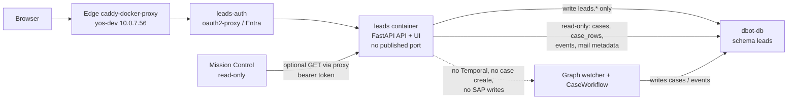

# Convention Leads — current plan

**Status: planning only — nothing built.**

Consolidated on 10 November 2026 (Asia/Jerusalem) from the plan versions sent to Zima that day, with every later decision applied. The short-lived rename to “Pipeline” was cancelled: the product, service, container, auth proxy, DB role and Entra roles stay **Leads** (`leads`, `dbot_leads`, `leads-auth`, `leads.dayo-tech.com`, `leads_viewer`, `leads_editor`). Never use pipeline names for those.

This is still planning only. Do not build, deploy, or contact anyone outside the team.

---

## 1. What this is

A separate convention-leads system that runs alongside the existing quotation/sales loop (cases, SAP won/lost). It starts from the electronica 2026 exhibitor list (3,665 companies: addresses, booths, emails, phones, industries) and is meant to be reused at later shows.

The current system has no leads CRM. It is a quotation loop that starts from sales mail. `cases-mcp` (formerly knowledge-mcp) holds workflow state in Postgres, not the company knowledge base.

**Companies live in the D-bot Postgres database (`dbot-db`), in their own `leads` schema — not in the wiki.** The Outline wiki or Obsidian can later show generated pages as a view for people (“Never type the same fact in two places”). Excel is an import/export format only, not the store.

**The UI is a new, separate app** (its own codebase and screens), not a section of Mission Control. Mission Control stays read-only: it never writes to `leads`, and only reads from the Leads API or links to it.

**A lead only links to existing cases.** Leads never creates a case and has no Temporal client, no start-workflow path, and no Temporal network.

---

## 2. Architecture (current)

One FastAPI service at `services/leads/` serves both the API and the UI (HTMX/daisyUI, or a static SPA build served by the same app), in a single container named `leads`.

Deployed on the existing Internal Services host **yos-dev (10.0.7.56)**, next to Plane, Outline, Mission Control and the MCPs. No new server. The deploy shape copies Mission Control: own compose project (`docker compose -p leads` or Portainer), own stack, **no published port**.

- Networks: `proxy` (so the login proxy can reach it) and `dbot-db` (Postgres) only. Not `mcp`. Not Temporal.
- Route: **`leads.dayo-tech.com`** (proposed; still an open question). Covered by the edge Caddy wildcard `*.dayo-tech.com` cert. Own login cookie and app roles. Plain `/` paths. Add the name in AD DNS (10.0.7.121, pointing at 10.0.7.56), same as the other internal names.
- Auth: a new oauth2-proxy instance, `leads-auth`, in `dayo-internal-services/stacks/sso`, next to `cases-auth`. It owns `leads.dayo-tech.com` through caddy-docker-proxy labels and forwards to `http://leads:8000` on `proxy`.
- Data: same Postgres (`dbot-db:5432`), schema `leads`, role `dbot_leads`. DSN from a Docker secret file. No traffic leaves the host. No data copying.
- Code lives in d-bot-orchestra; the route and `leads-auth` live in dayo-internal-services (sso and edge stacks) — two repos, the same split as Mission Control.

A path such as `cases.dayo-tech.com/leads` was considered and is **not recommended**: it would sit behind Mission Control’s login proxy, need a `/leads` base path, and blur Mission Control’s read-only boundary.

---

## 3. Link-only rule and rationale

**Leads can only link a lead to an existing case and never creates one.**

This is the rationale for that decision (item 3), from Vartan’s diagram “flow customer into sales is new case”:

> In the existing architecture, per Vartan’s diagram “flow customer into sales is new case”, anything from a customer that reaches Sales already turns into a case on its own. Mail to sales@ goes through the Graph API to the Graph watcher, which stores it in Postgres (cases, rows, events) and starts one Temporal CaseWorkflow per case (prepare, act, observe, close). In close, SAP decides won or lost through the quotation/order poll. Operations@ drafts are sent by people, and dbot-mirror@ BCC copies of external mail also feed the watcher. Case creation is already covered by the existing flow, so the leads system needs no manual create option.

So Leads only links a lead to a case the watcher has already opened (manually, or by accepting a suggestion), and reads won or lost from that case’s `case.closed`.

**Removed from earlier drafts:** the Temporal client, the start-workflow path, the Temporal network, and `POST /api/leads/{id}/case`.

---

## 4. What can be reused from today

- **Postgres (`dbot-db`, migrations 001–005):** `mails`, `threads_processed`, `cases` (one quotation request, with `card_code`, `loop_case_id`, `sap_quotation`, `sap_order`, unconstrained `status`), `case_rows` (open → rfq-sent → priced → quoted → ordered/dropped), `quotes` (supplier offers, not sales quotes), `customer_items`, `supplier_items`, and `events` (the loop’s diary). There are no companies, contacts, conventions or leads tables today.
- **Won and lost:** SAP is the source of truth. The Temporal loop polls `find_quotation` and `find_order`. Won when a customer order (ORDR) appears, which writes `case.closed` with outcome won. Lost when the quotation due date passes or the customer declines by mail. Mission Control reads `case.closed` events, not `cases.status`. Gap: the backfill’s `save_case` can’t store won/lost, and it rejects Lead CardCodes (`cLid`).
- **SAP:** business partners are customer, lead (`cLid`) or supplier. sap-mcp can resolve, history, and create/update/cancel quotations, plus quotation to order. **No tool creates a business partner or lead.** A case requires a customer CardCode (`cCustomer`). A `cLid` can sit on the company early, but a case only accepts a customer CardCode.
- **UI today:** Mission Control at `cases.dayo-tech.com` (FastAPI, Jinja, HTMX, daisyUI, Entra, read-only). Board, case story, inbox, closed (won/lost filter), search. Outcomes and studies pages are empty placeholders.
- **Agents:** mail-analyzer, supplier-expert, d-bot, tech-agent. No leads agent and no convention importer.
- Event kinds already emitted on master: `case.started`, `mail.received`, `mail.sent`, `sap.quotation`, `sap.order`, `sap.polled`, `case.closed` (also `sap.poll_failed`, `sap.unavailable`, `mail.redispatched` in the loop).

---

## 5. Schema (`leads` in dbot-db)

Role `dbot_leads`: write on `leads.*` only; read-only (`SELECT`) on `public.cases`, `public.case_rows`, `public.events`, and `public.mails` limited to the metadata columns (`conversation_id`, `from_addr`, `subject`, `received`) that domain matching needs. It never reads mail bodies (same rule as `dbot_viewer`). Nothing in Leads writes to the case loop or to SAP.

### Tables

- **`conventions`** `(id, name, slug, city, country, starts_on, ends_on)`
- **`companies`** `(id, name, name_normalized, domain, country, city, address, phone, primary_email, website, categories, description, profile_url, sap_card_code, sap_card_type)`, plus `categories text[]` (not free text), `source`, `import_batch_id`, and `raw jsonb` (the original Excel row). Every one of the 3,665 electronica 2026 companies gets a row.
- **`import_batches`** `(id, convention_id, file, rows, created, updated, skipped, at)`. Upsert on the dedupe key (domain, falling back to normalized name) so the import can run again safely. The next convention reuses the company: it gets a new `convention_appearances` row, not a duplicate.
- **`convention_appearances`** `(company_id, convention_id, hall_booth, met_at_booth)`, unique on company plus convention.
- **`contacts`** `(company_id, name, title, email, phone)`, unique on company plus lowercased email.
- **`leads`** `(company_id, appearance_id, contact_id, owner, stage, notes, follow_up_on, meeting_note_url, outcome, outcome_reason, outcome_at)`. Created only by the “Open lead” button, never by the import. Only one open lead per company at a time (partial unique index on `company_id` where `outcome` is null). A new lead becomes possible after a won or lost.
- **`lead_cases`** `(lead_id, case_id, loop_case_id, linked_by, linked_at, how)` — replaces a single `case_id`/`loop_case_id` on `leads`. `how` is `manual` or `suggested`. A lead often spans several quotes, so it needs more than one case. `sap_quotation` / `sap_order` live on `lead_cases`, or are read live from `cases` (preferred, to avoid copies).
- **`case_suggestions`** `(id, lead_id, case_id, reason, score, status, created_at)`. `reason` is `card_code`, `contact_email` or `domain`. `status` is `pending`, `accepted` or `dismissed`. A dismissed match is not suggested again.
- **`lead_events`** `(lead_id, kind, at, actor, data)`. Kinds include `opened`, `stage_changed`, `case_linked`, `outcome_synced`.

**Dedupe:** company key is the domain from the website or email, falling back to the normalized name, with manual merge for groups with several legal entities. Contact key is company plus email.

### Search indexes (companies table)

- **Name:** `pg_trgm` GIN indexes on `name` and `name_normalized`, for fuzzy and partial matches that include Hebrew.
- **Full text:** a `tsvector` over name, description and categories with a GIN index, using the `simple` config because the content is mixed language.
- **Categories:** a GIN index on `categories` for filter chips.
- **Filters:** btree indexes on `country`, `domain`, `sap_card_code`, and `(convention_id)` on appearances.
- 3,665 rows is small: server-side paging and sorting at about 50 a page is enough. No separate search engine.

---

## 6. Auto-suggest, tied to watcher events

The sync job reads `public.events` by `seq` (poll every minute or so, or LISTEN/NOTIFY). It matches against companies that have an open lead. A match creates a **pending** suggestion (badge on the lead card and a “Suggested cases” panel). A person confirms it with one click. **Nothing links automatically.** Zima confirmed this event-trigger mapping needs no changes.

**Triggers**

- **`case.started` (primary):** the watcher has opened a new case and the CaseWorkflow has started. This is the main trigger. Match the sender’s email against `contacts.email`, then the sender’s domain against `companies.domain`.
- **`card_code` goes from null to a value (recheck):** at `case.started` the CardCode is usually still null, because the analyzer resolves the customer in the prepare step. Re-check whenever `cases.card_code` goes from null to a value (poll `cases.updated_at`, or on the next event for that case). The strongest match, CardCode against `companies.sap_card_code`, happens at that point.
- **`mail.received` on an existing case (optional):** catches a new contact replying on a thread that’s already open. Suggest a link only if the case isn’t linked yet.
- **`sap.quotation` / `sap.order`:** display only. They show the quotation and order numbers on the linked lead card. They do not trigger matching.
- **`case.closed`:** sets won or lost on linked leads from the SAP poll’s outcome, using the multi-case rule below.

**Match order**

1. `cases.card_code` = `companies.sap_card_code` (strongest).
2. Sender of the case’s mail = a `contacts.email`.
3. Sender’s domain = `companies.domain` (catches new customers whose `card_code` is still null).

**Exclusions and mailboxes**

- Exclude free-mail domains (gmail, outlook and the like) and our own `dayo-tech.com`.
- Cases can start from sales@, operations@, or dbot-mirror@ BCC copies. Matching uses the external sender or recipient address, never our own `dayo-tech.com` or the mirror address, so BCC copies match the same way as direct mail.
- Operations@ mail that people send also lands as events, but it is our side talking. The match should look at the customer address on the thread, not the From of our own drafts.

If the watcher, rather than the orchestrator, is what writes `case.started`, that does not change anything for Leads.

---

## 7. Won / lost (proposed multi-case rule)

Unchanged source: the outcome comes from `case.closed` on linked cases. A small sync job writes `outcome`, `outcome_reason` and `outcome_at`, moves the stage to won or lost, and adds an `outcome_synced` event. SAP stays the source of truth; nobody sets won or lost by hand once a case exists.

**Proposed rule (not yet confirmed):** the lead is **won** as soon as any linked case closes as won. It is **lost** only when every linked case has closed as lost and nobody has moved the lead back to `follow_up`. If one case is still open, the lead stays in play.

---

## 8. API (proposed)

Leads API, for its own UI and (optionally) for Mission Control:

- `GET /api/companies?q=&country=&category=&convention=&has_lead=&page=` and `GET /api/companies/{id}` (includes contacts, appearances and the current lead).
- `POST /api/companies/{id}/leads` — the “Open lead” button. Body: owner, contact_id, appearance_id and notes.
- `GET /api/leads?stage=&owner=&convention=` — the opened-leads board. `PATCH /api/leads/{id}` changes stage, owner, follow-up or notes.
- `GET /api/leads/by-case/{loop_case_id}` — lets Mission Control show “from lead X, electronica 2026” with a link on the case page.
- `GET /api/cases/search?q=&card_code=&from=&to=&loop_case_id=` — search existing cases by customer name (`customer_raw`), CardCode, date range or `intake-…` id.
- `POST /api/leads/{id}/cases {case_id}` links a case; `DELETE /api/leads/{id}/cases/{case_id}` unlinks it.
- `GET /api/leads/{id}/suggestions`, then `POST .../suggestions/{id}/accept|dismiss`.

Mission Control may call `http://leads:8000/api/...` over `proxy` with a bearer token from a secret file. Leads reads cases/events directly from the database, so Mission Control JSON endpoints from an earlier draft (`GET /api/cases/{loop_case_id}`, `GET /api/events?kind=case.closed&since_seq=`) are optional. Service-to-service tokens follow the MCP shared-auth pattern (secret files), or Entra client credentials if preferred. There is no leads-to-orchestrator token, because Leads does not start workflows.

`POST /api/leads/{id}/case` (create a new case) is **removed**.

---

## 9. Stages

With today’s equivalents. The board of opened leads uses these columns (except `imported` and the optional `stale`, which stay off the board).

| Stage | Meaning |
|---|---|
| **imported** | Exhibitor list only, no case yet. Imported companies that were never met stay in the directory so they don’t flood the board. |
| **met** | The export’s “Met at booth”. |
| **follow_up** | The export’s “Follow-up date”. |
| **qualified** | An SAP CardCode is linked. |
| **in_play** | A case is open, at board Prepare or RFQ out. |
| **quoted** | Board Quote out, a row is quoted, and `sap_quotation` is set. |
| **won** | `case.closed` with outcome won (an ORDR exists). |
| **lost** | `case.closed` with outcome lost, or a row is dropped. |
| **stale** | Optional. Exists only in catalogue practice today (60+ days of silence), not in the live loop. |

Whether the board columns should be exactly these stages is still an open question.

---

## 10. Screens

- **Companies:** all imported companies, with search, filters (country, category, convention, met, has lead, SAP-linked), a details drawer (contacts, booths across conventions, meeting-note link) and an “Open lead” button, which turns into “View lead” when a lead is open.
- **Opened-leads board:** opened leads only. Columns: met, follow_up, qualified, in_play, quoted, won and lost. Each card shows owner, follow-up date, a case link and the SAP quotation or order number, with filters by convention and owner, and won/lost totals.
- **Optional third screen:** conventions, showing the import history and per-show stats.

Company card shows details, SAP CardCode and type, contacts, every convention appearance (booth, met or not) and the meeting-note link. Links go through to the case page and the SAP quotation and order numbers. Won/lost reporting by convention, owner and industry.

---

## 11. Auth

- **Users:** Entra sign-in through oauth2-proxy (`leads-auth`), same pattern as Mission Control, with app roles `leads_viewer` and `leads_editor`. Only editors can open leads or change stages. The app reads the user and roles from the headers oauth2-proxy passes on.
- **Entra registration (open question):** either a new redirect URI `https://leads.dayo-tech.com/oauth2/callback` on the existing cases app registration, or its own registration if we want separate app roles. Recommendation: its own registration for the roles. One proxy instance per app is the existing pattern. A single shared proxy for several hosts is possible but would change `cases-auth`, so leave it alone.
- **Database:** `dbot_leads` as above. Mission Control keeps `dbot_viewer`, plus read on `leads.*` only if it should show lead info directly instead of through the API.

---

## 12. Resource estimate (unmeasured)

Heading in the yos-dev plan: “Resource impact on yos-dev (estimate, not measured).”

- Leads app: one FastAPI container, roughly 100 to 250 MB RAM, near-zero CPU when idle. Extra oauth2-proxy: about 20 to 40 MB. Together on the order of 150–300 MB RAM.
- Database: 3,665 companies plus contacts and leads is a few MB including the trigram/full-text indexes. A `dbot_leads` pool of 1 to 5 connections, the same size as cases-mcp.
- The outcome-sync job is a lightweight poll of `events` every minute or so, or LISTEN/NOTIFY.
- Overall it is small next to Plane, Outline and Temporal.

**These figures have not been measured.** Current RAM and disk usage on the host is unknown. Before any deploy, check headroom with `docker stats` and `free -h` on yos-dev.

---

## 13. Meetings and contact tracking (interim, while Leads is unbuilt)

This is the proposal sent to Zima for electronica 2026, and is separate from the app above. Don’t contact anyone outside the team yet. The end-of-day digest, the convention skill, and follow-up emails wait for Vartan’s own approval.

**Split**

- **Zima:** the exhibitor/lead Excel (master list of leads), contact cards, and the calendar for follow-up meetings.
- **bogo:** the “Conventions Leads” epic in Jira, with one task per lead that needs a follow-up and a sub-task per action item.
- **adva:** the meetings themselves — capture each booth conversation, write the summary, pull out the follow-ups, and produce the diagram.

**Per meeting, from adva**

- An Obsidian-ready Markdown note in `Conventions/<event-year>/` (for now `Conventions/electronica-2026/<Company>.md`). Frontmatter: company, contact names, roles, stand number, date, who met them (Vartan or Yossi), interest level, product or topic, and the next step with a due date. Body: summary, action items, open questions, and any quotes or prices mentioned.
- An Excalidraw sketch when the meeting is technical or product-heavy.
- A short hand-off line to Zima (company, contacts, interest level, next step) so the Excel row can be updated, and the action items to bogo as tasks under the epic.
- Vartan or Yossi can voice-note or call right after a booth visit, or send a business-card photo.

**Daily (only if Vartan approves):** an end-of-day digest for Vartan and Yossi — who they met, hot leads, and follow-ups owed.

**After the show (only if Vartan approves):** an event summary note with a lead ranking and the follow-up plan; draft follow-up emails as cards for Vartan to send himself. The folder layout plus the note template can be saved as a reusable convention skill.

**Shared key:** company name plus contact email, across the Excel row, the Jira task and the note. Excel has a `Meeting note` link column.

**Zima’s Excel columns**

- Exhibitors sheet: Company, Country, City, Address, Phone, Primary email, Website, Hall/Booth, Categories, Description, Profile URL, Met at booth, Lead status, Owner, Notes, Follow-up date, Meeting note.
- Contacts sheet: Company, Name, Title, Email, Phone.

**Jira:** epic [DEV-205 Conventions Leads](https://dayo-tech.atlassian.net/browse/DEV-205), tasks all assigned to Vartan:

- [DEV-206](https://dayo-tech.atlassian.net/browse/DEV-206) — Export the electronica 2026 exhibitors list to Excel (In Progress).
- [DEV-207](https://dayo-tech.atlassian.net/browse/DEV-207) — Log new contacts from the convention.
- [DEV-208](https://dayo-tech.atlassian.net/browse/DEV-208) — Follow up with leads after the convention.
- [DEV-209](https://dayo-tech.atlassian.net/browse/DEV-209) — Build a reusable platform for the next convention.

bogo would only create Jira tickets for leads actually qualified, not all 3,665 exhibitors. Yossi only has Viewer access in DEV, so he can’t be assigned; his leads would get an `owner-yossi` label unless he is made a Member. DEV-205 is not mentioned in the d-bot-orchestra repo.

---

## 14. Open questions for Vartan

**Still open**

1. **The multi-case won/lost rule** in section 7 (won as soon as any linked case closes as won; lost only when every linked case has closed as lost).
2. **Hostname:** is `leads.dayo-tech.com` OK?
3. **Entra:** own app registration with leads roles, or a redirect added to the cases registration?
4. **SAP:** who creates the business partner for a brand-new company? Until then, matching for them relies on email and domain. sap-mcp has no create-BP tool; it is either done manually in SAP, or a create-BP tool is added.
5. Same database with a separate schema (recommended, and assumed in this plan) vs a fully separate database?
6. Should the opened-leads board columns be exactly the stages in section 9?
7. Where do meeting notes live long-term: Obsidian, the wiki, or just a URL (`meeting_note_url`)?
8. Which is the source of truth for follow-up dates: the Excel or calendar, or Jira DEV-205?
9. How do we dedupe Hebrew names, companies with no domain, and groups with several legal entities? (The planned key is domain, then normalized name, with manual merge for groups.)

**Already decided (kept here so they are not re-opened)**

- Import all 3,665 companies into the DB and the UI (directory). A lead is created only by “Open lead”, not for every exhibitor.
- One open lead per company at a time. After won or lost, a new lead is allowed (including when a lost company shows up at the next convention).
- Separate app; Mission Control stays read-only; Leads writes only `leads.*`.
- Link only, never create a case. No Temporal path.
- Name stays Leads (the Pipeline rename was cancelled).
- Deploy on yos-dev as one container, no published port, behind edge Caddy + `leads-auth`.

---

## 15. Superseded ideas (do not implement)

- A new section inside Mission Control, with write access on the `leads` schema.
- Creating a case from a lead via the orchestrator / Temporal client (`POST /api/leads/{id}/case`, intake workflow id `intake-…`, lead id in the input, `NumAtCard = intake-…`).
- Joining the Temporal Docker network.
- Renaming the system Pipeline (`pipeline.dayo-tech.com`, `services/pipeline/`, `pipeline-auth`, `dbot_pipeline`, `pipeline_viewer` / `pipeline_editor`). Cancelled; names stay Leads. The DB schema was going to stay `leads` even during that rename.
- A path route under `cases.dayo-tech.com/leads`.

---

## Sources

Plan versions sent to Zima on 10 November 2026, and the later decisions applied on top of them: first data-model plan; separate-app and import-all-3,665 update; yos-dev deployment update; Pipeline rename and its cancellation; link-only update; auto-suggest trigger mapping (Zima: no changes needed); rationale for item 3 from Vartan’s “flow customer into sales is new case” diagram.

Repo references cited in the first plan: `services/dbot-db/migrations/001–005`, `services/mcp/cases-mcp`, `sap-mcp/tools/{customers,caseflow,quotations,operations}.py`, `services/orchestrator/.../workflows/case.py`, `services/mission-control`, `design/Design/{Case table,Mission control}.md`, `agents/mail-analyzer-agent/.claude/skills/client-catalogue/SKILL.md`. The yos-dev plan was based on the tech-agent ops runbook and the compose files for Mission Control and the orchestrator.

Intended git home (not written in this step): `git@github.com:dayovartan/lead-pipeline-dashboard.git`.
