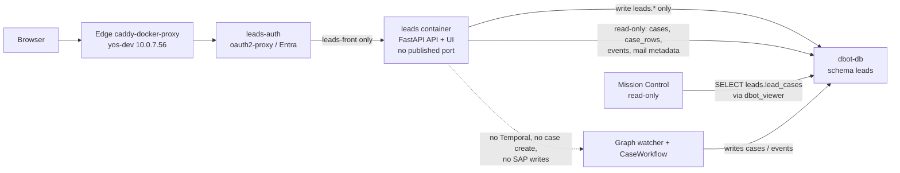

# Convention Leads — current plan

**Status: planning only — nothing built.**

Revised 10 Nov 2026 after review against dbot-db migrations 001-005.

Consolidated on 10 November 2026 (Asia/Jerusalem) from the plan versions sent to Zima that day, with every later decision applied. Revised the same day against `services/dbot-db/migrations/001_init.sql` through `005_viewer_role.sql` in dbotOrchestra (corrections landed in the body of this plan, not as a separate issues list). The short-lived rename to “Pipeline” was cancelled: the product, service, container, auth proxy, DB role and Entra roles stay **Leads** (`leads`, `dbot_leads`, `leads-auth`, `leads.dayo-tech.com`, `leads_viewer`, `leads_editor`). Never use pipeline names for those.

This is still planning only. Do not build, deploy, or contact anyone outside the team.

---

## 1. What this is

A separate convention-leads system that runs alongside the existing quotation/sales loop (cases, SAP won/lost). It starts from the electronica 2026 exhibitor list (3,665 companies: addresses, booths, emails, phones, industries) and is meant to be reused at later shows.

The current system has no leads CRM. It is a quotation loop that starts from sales mail. `cases-mcp` (formerly knowledge-mcp) holds workflow state in Postgres, not the company knowledge base.

**Companies live in the D-bot Postgres database (`dbot-db`), in their own `leads` schema — not in the wiki.** The Outline wiki or Obsidian can later show generated pages as a view for people (“Never type the same fact in two places”). Excel is an import/export format only, not the store.

**The UI is a new, separate app** (its own codebase and screens), not a section of Mission Control. Mission Control stays read-only: it never writes to `leads`. It reads lead-to-case links with a `SELECT` grant on `leads.lead_cases` (see section 11), not through a Leads API token.

**A lead only links to existing cases.** Leads never creates a case and has no Temporal client, no start-workflow path, and no Temporal network.

---

## 2. Architecture (current)

One FastAPI service at `services/leads/` serves both the API and the UI (HTMX/daisyUI, or a static SPA build served by the same app), in a single container named `leads`.

Deployed on the existing Internal Services host **yos-dev (10.0.7.56)**, next to Plane, Outline, Mission Control and the MCPs. No new server. The deploy shape copies Mission Control: own compose project (`docker compose -p leads` or Portainer), own stack, **no published port**.

- Networks: a private `leads-front` network shared only with `leads-auth`, and `dbot-db` (Postgres). The app itself is **not** on `proxy` (so other containers on `proxy` cannot reach `leads:8000` and spoof login headers). `leads-auth` sits on both `proxy` and `leads-front`. Not `mcp`. Not Temporal.
- Route: **`leads.dayo-tech.com`** (proposed; still an open question). Covered by the edge Caddy wildcard `*.dayo-tech.com` cert. Own login cookie and app roles. Plain `/` paths. Add the name in AD DNS (10.0.7.121, pointing at 10.0.7.56), same as the other internal names.
- Auth: a new oauth2-proxy instance, `leads-auth`, in `dayo-internal-services/stacks/sso`, next to `cases-auth`. It owns `leads.dayo-tech.com` through caddy-docker-proxy labels and forwards to `http://leads:8000` on `leads-front`. See section 11: the app must not trust those headers unless they come from `leads-auth`.
- Data: same Postgres (`dbot-db:5432`), schema `leads`, role `dbot_leads`. DSN from a Docker secret file. No traffic leaves the host. No data copying.
- Code lives in d-bot-orchestra; the route and `leads-auth` live in dayo-internal-services (sso and edge stacks) — two repos, the same split as Mission Control.

A path such as `cases.dayo-tech.com/leads` was considered and is **not recommended**: it would sit behind Mission Control’s login proxy, need a `/leads` base path, and blur Mission Control’s read-only boundary.

---

## 3. Link-only rule and rationale

**Leads can only link a lead to an existing case and never creates one.**

This is the rationale for that decision (item 3), from Vartan’s diagram “flow customer into sales is new case”:

> In the existing architecture, per Vartan’s diagram “flow customer into sales is new case”, anything from a customer that reaches Sales already turns into a case on its own. Mail to sales@ goes through the Graph API to the Graph watcher, which stores it in Postgres (cases, rows, events) and starts one Temporal CaseWorkflow per case (prepare, act, observe, close). In close, SAP decides won or lost through the quotation/order poll. Operations@ drafts are sent by people, and dbot-mirror@ BCC copies of external mail also feed the watcher. Case creation is already covered by the existing flow, so the leads system needs no manual create option.

So Leads only links a lead to a case the watcher has already opened (manually, or by accepting a suggestion), and reads won or lost from that case’s `case.closed`.

**Removed from earlier drafts:** the Temporal client, the start-workflow path, the Temporal network, and `POST /api/leads/{id}/case`.

---

## 4. What can be reused from today

- **Postgres (`dbot-db`, migrations 001–005):** `mails`, `threads_processed`, `cases` (one quotation request, with `card_code`, `loop_case_id`, `sap_quotation`, `sap_order`, unconstrained `status`; **no `updated_at`**), `case_rows` (open → rfq-sent → priced → quoted → ordered/dropped), `quotes` (supplier offers, not sales quotes), `customer_items`, `supplier_items`, and `events` (the loop’s diary: `id bigserial` primary key, unique on `(case_id, seq)`). `cases.sap_quotation` and `cases.sap_order` are SAP **DocEntry** (OQUT / ORDR), not the printed **DocNum**. There are no companies, contacts, conventions or leads tables today. The installed extensions are `vector` and `pgcrypto` (001); **`pg_trgm` is not installed**.
- **Won and lost:** SAP is the source of truth. The Temporal loop polls `find_quotation` and `find_order`. Won when a customer order (ORDR) appears, which writes `case.closed` with outcome won. Lost when the quotation due date passes or the customer declines by mail. Mission Control reads `case.closed` events, not `cases.status`. Gap: the backfill’s `save_case` can’t store won/lost, and it rejects Lead CardCodes (`cLid`).
- **SAP:** business partners are customer, lead (`cLid`) or supplier. sap-mcp can resolve, history, and create/update/cancel quotations, plus quotation to order. **No tool creates a business partner or lead.** A case requires a customer CardCode (`cCustomer`). A `cLid` can sit on the company early, but a case only accepts a customer CardCode.
- **UI today:** Mission Control at `cases.dayo-tech.com` (FastAPI, Jinja, HTMX, daisyUI, Entra, read-only). Board, case story, inbox, closed (won/lost filter), search. Outcomes and studies pages are empty placeholders. Mission Control itself currently displays `cases.sap_quotation` / `cases.sap_order` (DocEntry).
- **Agents:** mail-analyzer, supplier-expert, d-bot, tech-agent. No leads agent and no convention importer.
- Event kinds already emitted on master: `case.started`, `mail.received`, `mail.sent`, `sap.quotation`, `sap.order`, `sap.polled`, `case.closed` (also `sap.poll_failed`, `sap.unavailable`, `mail.redispatched` in the loop). `sap.quotation` / `sap.order` events store `doc_num` (the printed DocNum) in `events.data`, along with totals / validity — not the address fields, which 003 forbids.

---

## 5. Schema (`leads` in dbot-db)

Role `dbot_leads`: write on `leads.*` only; read-only (`SELECT`) on `public.cases`, `public.case_rows`, `public.events`, and a column-limited `SELECT` on `public.mails`.

**Mail columns granted to `dbot_leads`:** `id`, `conversation_id`, `mailbox`, `from_addr`, `from_name`, `to_addrs`, `cc_addrs`, `subject`, `received_at`. The column is **`received_at`**, not `received` (001). **Recommended: grant `to_addrs` and `cc_addrs`** so matching can see the customer as a recipient on operations@ drafts and dbot-mirror@ BCC copies. That is a wider grant than `dbot_viewer` (005 explicitly withholds `body_text`, `to_addrs` and `cc_addrs`). Still never grant `body_text`, and never grant `tsv` (it is generated from subject **and** `body_text`, so it would leak bodies). The alternative — drop recipient matching and rely only on `from_addr` — would miss outbound-only threads until the customer replies; that is not recommended.

Nothing in Leads writes to the case loop or to SAP.

### Tables

- **`conventions`** `(id, name, slug, city, country, starts_on, ends_on)`
- **`companies`** `(id, name, name_normalized, domain, country, city, address, phone, primary_email, website, categories, description, profile_url, sap_card_code, sap_card_type)`, plus `categories text[]` (not free text), `source`, `import_batch_id`, `raw jsonb` (the latest Excel row, always refreshed on import), and `edited_fields text[]` (columns a person changed in the app). Every one of the 3,665 electronica 2026 companies gets a row.
- **`import_batches`** `(id, convention_id, file, rows, created, updated, skipped, at)`. Upsert on the dedupe key (domain, falling back to normalized name) so the import can run again safely. The next convention reuses the company: it gets a new `convention_appearances` row, not a duplicate.
- **`convention_appearances`** `(company_id, convention_id, hall_booth, met_at_booth)`, unique on company plus convention.
- **`contacts`** `(company_id, name, title, email, phone)`, unique on company plus lowercased email. These are personal data; see GDPR below.
- **`leads`** `(company_id, appearance_id, contact_id, owner, stage, notes, follow_up_on, meeting_note_url, outcome, outcome_reason, outcome_at)`. Created by the “Open lead” button, or once by the first migration import for Excel rows that already have lead activity (see Import and merge). Only one open lead per company at a time (partial unique index on `company_id` where `outcome` is null). A new lead becomes possible after won, lost, or a manual drop.
- **`lead_cases`** `(lead_id, case_id, loop_case_id, linked_by, linked_at, how)` — replaces a single `case_id`/`loop_case_id` on `leads`. `case_id` is `cases.case_id` (uuid). `loop_case_id` is `cases.loop_case_id` and equals `events.case_id` (the CaseWorkflow id, `intake-…` text). `how` is `manual` or `suggested`. A lead often spans several quotes, so it needs more than one case. Prefer reading live from `cases` and `events` over copying SAP ids onto `lead_cases`.
- **`case_suggestions`** `(id, lead_id, case_id, reason, score, status, created_at)`. `reason` is `card_code`, `contact_email` or `domain`. `status` is `pending`, `accepted` or `dismissed`. A dismissed match is not suggested again.
- **`lead_events`** `(lead_id, kind, at, actor, data)`. Kinds include `opened`, `stage_changed`, `case_linked`, `outcome_synced`, `dropped`.
- **`sync_state`** `(name, last_event_id)` — watermark for the sync job. The cursor is **`public.events.id`** (`bigserial`), not `events.seq`. `seq` counts per case; `(case_id, seq)` is the unique key (003), so reading “by seq” as if it were global would skip or repeat events.

**Dedupe:** company key is the domain from the website or email, falling back to the normalized name, with manual merge for groups with several legal entities. Contact key is company plus email.

### Import and merge

Three sources feed the app; none of them stay the store once a row is in Postgres.

1. **Zima’s live Excel** (exhibitors + contacts sheets) is the catalogue import. First run (migration into the app): upsert all 3,665 companies, appearances and contacts. Also create a lead (same as “Open lead”) only for rows that already have lead activity — Met at booth, Lead status, Owner, Notes, or Follow-up date — and seed `owner`, `notes`, `follow_up_on`, `meeting_note_url`, `met_at_booth`, and stage from Lead status where the mapping is clear (the Excel status strings themselves are an open question). Later re-imports never create leads.
2. **Obsidian notes** (`Conventions/<event-year>/<Company>.md`) set `meeting_note_url` when that field is empty. They do not overwrite `leads.notes` once a person has edited notes in the app.
3. **Jira tasks** under [DEV-205](https://dayo-tech.atlassian.net/browse/DEV-205) are a reference for follow-ups. They may seed `follow_up_on` only when it is empty. They do not overwrite app dates.

**Re-import must not overwrite app edits.**

- Catalogue columns (name, address, phone, primary_email, website, categories, description, profile_url, hall_booth, imported contact fields): update on re-import only if that column is **not** listed in `edited_fields`. A save in the UI adds the column name there.
- App-owned columns, never written by re-import: `sap_card_code` and `sap_card_type` once set in the app, `owner`, `stage`, `notes`, `follow_up_on`, `meeting_note_url`, `outcome`, `outcome_reason`, `outcome_at`, case links, suggestions.
- `raw jsonb` is always replaced with the latest Excel row (the original import, not the live app values).
- Contacts upsert on company plus lowercased email. Re-import does not delete contacts that exist only in the app, and does not overwrite a contact field that is in that contact’s `edited_fields`.

### Search indexes (companies table)

- **Name:** `pg_trgm` GIN indexes on `name` and `name_normalized`, for fuzzy and partial matches, **after** the pre-build locale check below. `CREATE EXTENSION pg_trgm` belongs in **dbot-db migration 006**, applied by `dbot_owner` (the loop schema owner), because extensions are database-wide. It is not in 001–005.
- **Full text:** a `tsvector` over name, description and categories with a GIN index, using the `simple` config because the content is mixed language (001 already uses `simple` on `mails.tsv` so Hebrew and part numbers survive stemming).
- **Categories:** a GIN index on `categories` for filter chips.
- **Filters:** btree indexes on `country`, `domain`, `sap_card_code`, and `(convention_id)` on appearances.
- 3,665 rows is small: server-side paging and sorting at about 50 a page is enough. No separate search engine.

**Hebrew / `pg_trgm` pre-build check.** Trigram search drops characters that the database’s `LC_CTYPE` does not classify as letters. Before counting on `pg_trgm` for Hebrew company names, run `SHOW lc_ctype;` (or `SELECT datctype FROM pg_database WHERE datname = current_database();`) on `dbot` and a probe such as `SELECT show_trgm('שלום');`. If the ctype is `C` (or the probe returns no Hebrew trigrams), do not rely on `pg_trgm` for Hebrew: use `ILIKE` and the `simple` tsvector instead. This was not checked against the live yos-dev database in this revision.

### GDPR (exhibitor contacts)

Contacts collected at a Munich trade fair (names, emails, phones, titles, employer, booth) are personal data under the GDPR.

- **Purpose:** convention follow-up and B2B sales contact for Dayo, tied to a company and optionally a lead.
- **Retention:** keep a contact while there is an open lead, a linked case, or an active SAP customer (`sap_card_type = cCustomer`). After that, delete or anonymize. The exact retention period (a proposed default is 24 months after the convention ends, or sooner on request) is an **open question**.
- **Export:** an editor can export one company’s contacts, and can export every row about a person looked up by email (company, contacts, lead notes that name them).
- **Deletion:** delete the `contacts` row, remove them from open leads (`contact_id`), and redact that person from `companies.raw` / contact `raw` so a later export of `raw` does not resurrect them. Deletion is logged on `lead_events` without storing the deleted address again.
- **Legal basis:** typically legitimate interest for B2B trade-fair contacts. Confirm with whoever handles privacy before the first import of the 3,665-row file (open question).

---

## 6. Auto-suggest, tied to watcher events

The sync job polls `public.events` ordered by **`events.id`** (the `bigserial` primary key) and stores the last seen id in `leads.sync_state`. Poll about every minute. **Do not use `events.seq` as a global cursor.**

**Recommended: keep polling by `events.id`.** A `LISTEN/NOTIFY` trigger on `public.events` would be a change to the loop’s schema. If we ever add one, it belongs in the same dbot-db migration 006, owned by `dbot_owner` — but polling avoids touching the loop schema and is enough at this volume.

It matches against companies that have an open lead. A match creates a **pending** suggestion (badge on the lead card and a “Suggested cases” panel). A person confirms it with one click. **Nothing links automatically.** Zima confirmed this event-trigger mapping needs no changes.

**`events.data` has no addresses.** Migration 003: `data` holds “ids, counts, kinds; never mail bodies or addresses.” Sender and recipient matching must join out to `mails`.

**Join for addresses** (column names from 001, 003 and 004):

`events.case_id` (text, the CaseWorkflow id) → `cases.loop_case_id` → `cases.conversation_id` → `mails.conversation_id` → `mails.from_addr` (and, when granted, `mails.to_addrs` / `mails.cc_addrs`). Use `mails.received_at` for ordering, not a column named `received`.

When the event carries `data.mail_id` (`case.started`, `mail.received`, `mail.sent`), prefer `mails.id = data.mail_id` so the match uses that message, not every address on the thread. `case.started` also stores `data.conversation_id` and `data.mailbox`; `mail.received` stores `data.mail_id`, `data.party` and `data.from_domain` (a domain only, not a full address).

**Triggers**

- **`case.started` (primary):** the watcher has opened a new case and the CaseWorkflow has started. This is the main trigger. Match the sender’s email (`mails.from_addr` via the join above) against `contacts.email`, then the sender’s domain against `companies.domain`.
- **`card_code` goes from null to a value (recheck):** at `case.started` the CardCode is usually still null, because the analyzer resolves the customer in the prepare step. `cases.updated_at` **does not exist** (001 and 004: the table has `opened_at`, not `updated_at`), so a poll of `cases.updated_at` cannot see the change.

  **Recommended:** on each sync tick, scan cases that already have a `card_code` and that are either linked on `lead_cases` or have a pending `case_suggestions` row whose reason is not yet `card_code`, and run the CardCode match then. That needs no new column on `public.cases`.

  Alternative (not recommended unless the scan proves too coarse): add `cases.updated_at` plus a trigger in dbot-db migration 006 (`dbot_owner`). That would change the loop’s table.

  The strongest match, CardCode against `companies.sap_card_code`, happens at that recheck.

- **`mail.received` on an existing case (optional):** catches a new contact replying on a thread that’s already open. Suggest a link only if the case isn’t linked yet. Resolve the sender through the join (or `data.mail_id` → `mails.id`), not from `events.data`.
- **`sap.quotation` / `sap.order`:** display only. They do not trigger matching. Lead cards show the printed **DocNum** from `events.data->>'doc_num'` on the latest `sap.quotation` / `sap.order` for that case (`events.case_id = cases.loop_case_id`). Do not display `cases.sap_quotation` / `cases.sap_order` as if they were document numbers: those columns are DocEntry (004). The Leads app is not on the `mcp` network, so a live sap-mcp lookup is not planned; the event payload already has `doc_num`.
- **`case.closed`:** sets won or lost on linked leads from the SAP poll’s outcome, using the multi-case rule in section 7.

**Match order**

1. `cases.card_code` = `companies.sap_card_code` (strongest).
2. Sender of the case’s mail (`mails.from_addr` via the join) = a `contacts.email`.
3. Sender’s domain = `companies.domain` (catches new customers whose `card_code` is still null).
4. If the From is one of our own mailboxes, match an external address in `mails.to_addrs` / `mails.cc_addrs` the same way (email, then domain).

**Exclusions and mailboxes**

- Exclude free-mail domains (gmail, outlook and the like) and our own `dayo-tech.com`.
- Cases can start from sales@, operations@, or dbot-mirror@ BCC copies. Matching uses the external sender or recipient address, never our own `dayo-tech.com` or the mirror address, so BCC copies match the same way as direct mail.
- Operations@ mail that people send also lands as events, but it is our side talking. The match should look at the customer address on the thread (`to_addrs` / `cc_addrs`, or a later inbound `from_addr`), not the From of our own drafts.

If the watcher, rather than the orchestrator, is what writes `case.started`, that does not change anything for Leads.

---

## 7. Won / lost (proposed multi-case rule)

Unchanged source for SAP outcomes: they come from `case.closed` on linked cases. A small sync job writes `outcome`, `outcome_reason` and `outcome_at`, moves the stage to won or lost, and adds an `outcome_synced` event. SAP stays the source of truth; nobody sets won or lost by hand once a case is linked.

**Proposed rule (not yet confirmed):** the lead is **won** as soon as any linked case closes as won. It is **lost** only when every linked case has closed as lost and nobody has moved the lead back to `follow_up`. If one case is still open, the lead stays in play.

**Manual drop (needed so some leads can close).** A lead that never gets a case has no `case.closed`, so without a manual path it would block the “one open lead” partial unique index forever. Editors may **drop** a lead that has **no linked cases**. That sets `outcome` to `lost`, `outcome_reason` to `manual`, `outcome_at` to now, `stage` to `lost`, and writes a `dropped` lead event. After that, a new lead for the same company is allowed. Editors cannot drop a lead that still has a linked case, and cannot set won by hand. A dropped `case_rows` row (`status = 'dropped'`) does **not** make the lead lost.

---

## 8. API (proposed)

Leads API, for its own UI (Mission Control does not call it; see section 11):

- `GET /api/companies?q=&country=&category=&convention=&has_lead=&page=` and `GET /api/companies/{id}` (includes contacts, appearances and the current lead).
- `POST /api/companies/{id}/leads` — the “Open lead” button. Body: owner, contact_id, appearance_id and notes.
- `GET /api/leads?stage=&owner=&convention=` — the opened-leads board. `PATCH /api/leads/{id}` changes stage (only the people-set stages in section 9), owner, follow-up or notes.
- `POST /api/leads/{id}/drop` — manual drop, allowed only when the lead has no linked cases (section 7).
- `POST /api/leads/{id}/cases {case_id}` links a case; `DELETE /api/leads/{id}/cases/{case_id}` unlinks it.
- `GET /api/leads/{id}/suggestions`, then `POST .../suggestions/{id}/accept|dismiss`.
- `GET /api/cases/search?q=&card_code=&from=&to=&loop_case_id=` — search existing cases by customer name (`customer_raw`), CardCode, date range or `intake-…` id.
- `GET /api/contacts/export?email=` — GDPR export of rows about a person. `DELETE /api/contacts/{id}` — deletion with raw redaction.

`GET /api/leads/by-case/{loop_case_id}` is optional and unused if Mission Control reads `leads.lead_cases` directly. There is no Mission Control bearer token and no leads-to-orchestrator token.

`POST /api/leads/{id}/case` (create a new case) is **removed**.

---

## 9. Stages

With today’s equivalents. The board of opened leads uses these columns (except `imported` and the optional `stale`, which stay off the board).

A lead has one `stage`. **People set** some values; **the sync job sets** others. People cannot drag a card into a sync-set column.

| Stage | Who sets it | Meaning |
|---|---|---|
| **imported** | import (not a lead) | Exhibitor list only, no lead yet. Imported companies that were never met stay in the directory so they don’t flood the board. |
| **met** | person | The export’s “Met at booth”. Default when someone opens a lead. |
| **follow_up** | person | The export’s “Follow-up date”, or an editor moving the card. |
| **qualified** | person or sync | The company has an SAP CardCode (`companies.sap_card_code`). Editors may type one; sync may set this stage when a CardCode match lands and no case is linked yet. |
| **in_play** | sync | At least one linked case is still open, and it is not yet quoted. |
| **quoted** | sync | A linked case has a quotation: a row is `quoted` and/or a `sap.quotation` event (DocNum) exists. |
| **won** | sync | `case.closed` with outcome won (an ORDR exists), per section 7. |
| **lost** | sync, or person via drop | Sync: `case.closed` with outcome lost, per section 7. Person: manual drop of a lead with **no** linked case (section 7). A dropped case row does **not** count. |
| **stale** | optional, unused at first | Exists only in catalogue practice today (60+ days of silence), not in the live loop. |

**`in_play` while still unqualified is allowed.** A case often starts with `cases.card_code` still null. Linking that case moves the lead to `in_play` even if `companies.sap_card_code` is empty. When the CardCode appears later, the company is marked SAP-linked but the board column stays `in_play` (or `quoted`). `qualified` as a board column is for leads that have a CardCode and no linked case yet.

**Allowed transitions**

- Directory (`imported`) → `met` (Open lead; or `follow_up` if a date is set at once).
- Person: `met` ↔ `follow_up` ↔ `qualified`.
- Person: `met` / `follow_up` / `qualified` → `lost` via manual drop, only if there is no linked case.
- Sync: `met` / `follow_up` / `qualified` → `in_play` when a case is linked (skipping `qualified` is fine).
- Sync: `in_play` → `quoted`.
- Sync: `in_play` / `quoted` → `won` or `lost` from `case.closed` (section 7).
- `won` and `lost` end that lead. A new lead for the company is allowed afterwards.

Whether the board columns should be exactly these stages is still an open question.

---

## 10. Screens

- **Companies:** all imported companies, with search, filters (country, category, convention, met, has lead, SAP-linked), a details drawer (contacts, booths across conventions, meeting-note link) and an “Open lead” button, which turns into “View lead” when a lead is open.
- **Opened-leads board:** opened leads only. Columns: met, follow_up, qualified, in_play, quoted, won and lost. Each card shows owner, follow-up date, a case link and the SAP quotation or order **DocNum** (from `sap.quotation` / `sap.order` events, not DocEntry), with filters by convention and owner, and won/lost totals. Manually dropped leads appear under lost with reason `manual`.
- **Optional third screen:** conventions, showing the import history and per-show stats.

Company card shows details, SAP CardCode and type, contacts, every convention appearance (booth, met or not) and the meeting-note link. Links go through to the case page and the SAP quotation and order DocNums. Won/lost reporting by convention, owner and industry.

---

## 11. Auth

- **Users:** Entra sign-in through oauth2-proxy (`leads-auth`), same pattern as Mission Control, with app roles `leads_viewer` and `leads_editor`. Only editors can open leads, change people-set stages, or drop a lead. The app reads the user and roles from the headers oauth2-proxy passes on, **but it must not trust those headers unless they come from `leads-auth`**. Any container that could reach `leads:8000` could otherwise send a fake `X-Forwarded-User` / role header.

  **Recommended:** put `leads` and `leads-auth` on a private Docker network (`leads-front`) and do **not** attach the app to `proxy`, so only `leads-auth` can open `leads:8000`. Defense in depth: enable oauth2-proxy `--set-authorization-header` and verify the Entra ID token (JWT signature against Entra JWKS) rather than trusting unsigned email/role headers alone. A shared secret header that only `leads-auth` adds is a simpler alternative if both containers must stay on `proxy`.

- **Entra registration (open question):** either a new redirect URI `https://leads.dayo-tech.com/oauth2/callback` on the existing cases app registration, or its own registration if we want separate app roles. Recommendation: its own registration for the roles. One proxy instance per app is the existing pattern. A single shared proxy for several hosts is possible but would change `cases-auth`, so leave it alone.
- **Database:** `dbot_leads` as in section 5.
- **Mission Control:** **recommended: a `SELECT` grant on `leads.lead_cases` for `dbot_viewer`**, so Mission Control can show “from lead X” by joining in Postgres. No API token, no HTTP call to `leads:8000`. Grant further read-only tables (`leads.leads`, `leads.companies`) only if the case page needs names rather than ids. The earlier idea of `http://leads:8000/api/...` plus a bearer token is dropped for Mission Control.

---

## 12. Resource estimate (unmeasured)

Heading in the yos-dev plan: “Resource impact on yos-dev (estimate, not measured).”

- Leads app: one FastAPI container, roughly 100 to 250 MB RAM, near-zero CPU when idle. Extra oauth2-proxy: about 20 to 40 MB. Together on the order of 150–300 MB RAM.
- Database: 3,665 companies plus contacts and leads is a few MB including the trigram/full-text indexes. A `dbot_leads` pool of 1 to 5 connections, the same size as cases-mcp.
- The outcome-sync and suggest jobs are a lightweight poll of `events` by `id` every minute or so. LISTEN/NOTIFY is not planned (section 6).
- Overall it is small next to Plane, Outline and Temporal.

**These figures have not been measured.** Current RAM and disk usage on the host is unknown. Before any deploy, check headroom with `docker stats` and `free -h` on yos-dev.

---

## 13. Meetings and contact tracking (interim, while Leads is unbuilt)

This is the proposal sent to Zima for electronica 2026, and is separate from the app above. Don’t contact anyone outside the team yet. The end-of-day digest, the convention skill, and follow-up emails wait for Vartan’s own approval.

**Split**

- **Zima:** the exhibitor/lead Excel (master list of leads), contact cards, and the calendar for follow-up meetings.
- **bogo:** the “Conventions Leads” epic in Jira, with one task per lead that needs a follow-up and a sub-task per action item.
- **adva:** the meetings themselves — capture each booth conversation, write the summary, pull out the follow-ups, and produce the diagram.

**Per meeting, from adva**

- An Obsidian-ready Markdown note in `Conventions/<event-year>/` (for now `Conventions/electronica-2026/<Company>.md`). Frontmatter: company, contact names, roles, stand number, date, who met them (Vartan or Yossi), interest level, product or topic, and the next step with a due date. Body: summary, action items, open questions, and any quotes or prices mentioned.
- An Excalidraw sketch when the meeting is technical or product-heavy.
- A short hand-off line to Zima (company, contacts, interest level, next step) so the Excel row can be updated, and the action items to bogo as tasks under the epic.
- Vartan or Yossi can voice-note or call right after a booth visit, or send a business-card photo.

**Daily (only if Vartan approves):** an end-of-day digest for Vartan and Yossi — who they met, hot leads, and follow-ups owed.

**After the show (only if Vartan approves):** an event summary note with a lead ranking and the follow-up plan; draft follow-up emails as cards for Vartan to send himself. The folder layout plus the note template can be saved as a reusable convention skill.

**Shared key:** company name plus contact email, across the Excel row, the Jira task and the note. Excel has a `Meeting note` link column.

**Zima’s Excel columns**

- Exhibitors sheet: Company, Country, City, Address, Phone, Primary email, Website, Hall/Booth, Categories, Description, Profile URL, Met at booth, Lead status, Owner, Notes, Follow-up date, Meeting note.
- Contacts sheet: Company, Name, Title, Email, Phone.

**Jira:** epic [DEV-205 Conventions Leads](https://dayo-tech.atlassian.net/browse/DEV-205), tasks all assigned to Vartan:

- [DEV-206](https://dayo-tech.atlassian.net/browse/DEV-206) — Export the electronica 2026 exhibitors list to Excel (In Progress).
- [DEV-207](https://dayo-tech.atlassian.net/browse/DEV-207) — Log new contacts from the convention.
- [DEV-208](https://dayo-tech.atlassian.net/browse/DEV-208) — Follow up with leads after the convention.
- [DEV-209](https://dayo-tech.atlassian.net/browse/DEV-209) — Build a reusable platform for the next convention.

bogo would only create Jira tickets for leads actually qualified, not all 3,665 exhibitors. Yossi only has Viewer access in DEV, so he can’t be assigned; his leads would get an `owner-yossi` label unless he is made a Member. DEV-205 is not mentioned in the d-bot-orchestra repo.

---

## 14. Open questions for Vartan

**Still open**

1. **The multi-case won/lost rule** in section 7 (won as soon as any linked case closes as won; lost only when every linked case has closed as lost).
2. **Hostname:** is `leads.dayo-tech.com` OK?
3. **Entra:** own app registration with leads roles, or a redirect added to the cases registration?
4. **SAP:** who creates the business partner for a brand-new company? Until then, matching for them relies on email and domain. sap-mcp has no create-BP tool; it is either done manually in SAP, or a create-BP tool is added.
5. Same database with a separate schema (recommended, and assumed in this plan) vs a fully separate database?
6. Should the opened-leads board columns be exactly the stages in section 9?
7. Where do meeting notes live long-term: Obsidian, the wiki, or just a URL (`meeting_note_url`)?
8. Which is the source of truth for follow-up dates: the Excel or calendar, or Jira DEV-205?
9. How do we dedupe Hebrew names, companies with no domain, and groups with several legal entities? (The planned key is domain, then normalized name, with manual merge for groups.)
10. **GDPR:** confirm the retention period for exhibitor contacts (24 months after the convention ends is the proposal) and the legal basis (legitimate interest) before the first import.
11. How do the Excel “Lead status” strings map onto the stages in section 9 on the first migration import?

**Already decided (kept here so they are not re-opened)**

- Import all 3,665 companies into the DB and the UI (directory). A lead is created only by “Open lead”, except the one-time migration of Excel rows that already have lead activity.
- One open lead per company at a time. After won, lost, or a manual drop, a new lead is allowed (including when a lost company shows up at the next convention).
- Separate app; Mission Control stays read-only; Leads writes only `leads.*`.
- Link only, never create a case. No Temporal path.
- Name stays Leads (the Pipeline rename was cancelled).
- Deploy on yos-dev as one container, no published port, behind edge Caddy + `leads-auth`.
- Sync cursor is `events.id`. Lost never comes from a dropped case row. Re-import does not overwrite app edits.

---

## 15. Superseded ideas (do not implement)

- A new section inside Mission Control, with write access on the `leads` schema.
- Creating a case from a lead via the orchestrator / Temporal client (`POST /api/leads/{id}/case`, intake workflow id `intake-…`, lead id in the input, `NumAtCard = intake-…`).
- Joining the Temporal Docker network.
- Renaming the system Pipeline (`pipeline.dayo-tech.com`, `services/pipeline/`, `pipeline-auth`, `dbot_pipeline`, `pipeline_viewer` / `pipeline_editor`). Cancelled; names stay Leads. The DB schema was going to stay `leads` even during that rename.
- A path route under `cases.dayo-tech.com/leads`.
- Using `events.seq` as a global cursor, or `cases.updated_at` (the column does not exist).
- Displaying `cases.sap_quotation` / `cases.sap_order` as if they were DocNum.
- A Mission Control bearer token to `http://leads:8000` (replaced by a `SELECT` on `leads.lead_cases`).
- Trusting unsigned oauth2-proxy headers from any container that can reach the app.

---

## 16. MVP build order

Planning only; do not start these until Vartan says to build.

1. **Import and companies directory** — schema `leads`, role `dbot_leads`, migration 006 (`pg_trgm` plus grants), Excel upsert with the merge rules, company search/filters, contact GDPR export/delete stubs, locale check for Hebrew.
2. **Opened-leads board** — Open lead, people-set stages, notes, follow-up, meeting-note URL, manual drop, filters and totals.
3. **Auto-suggestions** — poll `events.id`, address join through `cases` / `mails`, CardCode scan, pending/accept/dismiss, exclusions.
4. **Outcome sync** — `case.closed` → won/lost per section 7, DocNum on cards from `sap.quotation` / `sap.order` events, Mission Control `SELECT` on `lead_cases`.

---

## 17. Tests, backups and rollback

**Tests (when building starts)**

- Importer: upsert on the dedupe key; re-import refreshes `raw` and unedited catalogue columns only; app-owned and `edited_fields` columns stay put; contacts are not deleted.
- Grants: `dbot_leads` can read the listed mail metadata including `to_addrs` / `cc_addrs` / `received_at`, and cannot read `body_text` or `tsv`.
- Matcher: CardCode, contact email, domain; skip free-mail and `dayo-tech.com`; recipient match on operations@ / BCC; cursor advances by `events.id` and does not use `seq`.
- Stages: people cannot set `in_play` / `quoted` / `won`; `in_play` is allowed while unqualified; manual drop refused when a case is linked; drop releases the one-open-lead index.
- Auth: a request that presents spoofed user/role headers without coming through `leads-auth` (or without a valid JWT) is rejected.

**Backups**

The `services/dbot-db/README.md` (read 10 Nov 2026) says nightly `pg_dump` (14 days) to a backup target agreed with the sysadmin, plus one restore test before real data, is **“Still to add.”** There is no working dump documented today. A database-wide dump of `dbot` would include schema `leads` once that dump exists; do not invent a separate Leads backup. Until the dump is in place, `leads` shares the same gap as the rest of dbot-db.

**Rollback**

Drop schema `leads` (`DROP SCHEMA leads CASCADE`), revoke `dbot_leads`, remove the `leads` compose stack and `leads-auth`, and remove the DNS name and Caddy labels. Leaving `pg_trgm` installed is harmless if migration 006 created it. Do not add, and therefore do not need to drop, a trigger on `public.events`. Loop tables (`cases`, `events`, `mails`) are untouched.

---

## Sources

Plan versions sent to Zima on 10 November 2026, and the later decisions applied on top of them: first data-model plan; separate-app and import-all-3,665 update; yos-dev deployment update; Pipeline rename and its cancellation; link-only update; auto-suggest trigger mapping (Zima: no changes needed); rationale for item 3 from Vartan’s “flow customer into sales is new case” diagram.

Revision of 10 November 2026 checked against dbotOrchestra `services/dbot-db/migrations/001_init.sql`, `002_roles.sql`, `003_events.sql`, `004_case_table.sql`, `005_viewer_role.sql`, `services/dbot-db/README.md`, and `services/orchestrator/src/orchestrator/workflows/case.py` (`case.started` / `mail.received` / `sap.quotation` / `sap.order` payloads).

Repo references cited in the first plan: `services/dbot-db/migrations/001–005`, `services/mcp/cases-mcp`, `sap-mcp/tools/{customers,caseflow,quotations,operations}.py`, `services/orchestrator/.../workflows/case.py`, `services/mission-control`, `design/Design/{Case table,Mission control}.md`, `agents/mail-analyzer-agent/.claude/skills/client-catalogue/SKILL.md`. The yos-dev plan was based on the tech-agent ops runbook and the compose files for Mission Control and the orchestrator.

Git home: `git@github.com:dayovartan/lead-pipeline-dashboard.git`.
