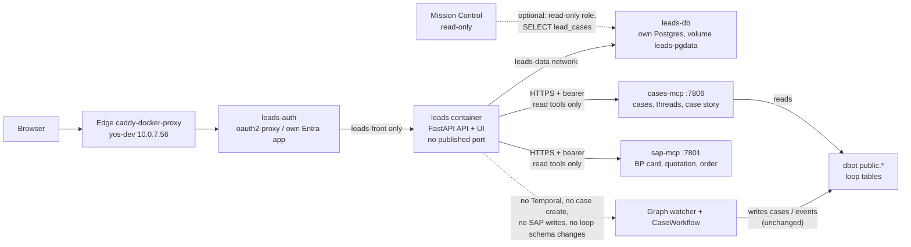

# Convention Leads — plan V2.1

**Status: planning only — nothing built.**

**V2.1, 10 November 2026 (Asia/Jerusalem).** V2 plus Vartan's answers on stack, storage, meetings and roles:

- **Its own app end to end:** own repo (`lead-pipeline-dashboard`), own deployment, own Entra app, own backend and frontend. The frontend is a React SPA (see [UI_PLAN.md](UI_PLAN.md)); Mission Control's stack is not copied.
- **Its own database:** a separate Postgres container (`leads-db`) on its own named volume, not dbot-db's database, schema or volume. `docker compose down` / `up` never loses data.
- **Meetings live in the app database:** a meeting is a dated entry with follow-up actions. Obsidian is an export only. Email and Microsoft 365 calendar integrations come later, from the dashboard.
- **Role is per show, kind is derived:** the role (lead, supplier, both, ignore) sits on each convention appearance; the company-level kind is computed from those roles, never stored.

**V2, 10 November 2026.** Rewritten after Vartan's review of V1. V1 is in git history (commit `5e46d51`). What changed:

- Leads is a **directory and a follow-up view**, not an event-driven machine. Companies, suppliers and their detail windows come first. Events are one optional feed, not the spine.
- **Nothing is added to the loop's database.** No migration 006, no `pg_trgm`, no LISTEN/NOTIFY, no trigger, no new column on `public.*`, no per-column grants. Search is plain `ILIKE`.
- **Cases and SAP come through the MCPs we already have**: cases-mcp for case knowledge, sap-mcp for quotation and order numbers. Leads stores no SAP document ids and does not pick between DocEntry and DocNum.
- **Leads are followed, never closed.** No won/lost stages, no close or drop logic, no one-open-lead-per-company rule, no stage machine.
- Auth spelled out: its own Entra app, `leads-auth` as the only way in. Mission Control reads lead links with a read-only `SELECT`, no API token.

Names stay **Leads** (`leads`, `dbot_leads`, `leads-auth`, `leads.dayo-tech.com`, `leads_viewer`, `leads_editor`). The “Pipeline” rename was cancelled. Never use pipeline names for those.

This is still planning only. Do not build, deploy, or contact anyone outside the team.

---

## 1. What this is

A separate convention-leads system next to the existing quotation/sales loop. It is where we **look at companies and suppliers**: one table of companies (exhibitors, customers, leads in SAP, suppliers), their contacts, the shows we met them at, and a detail window that pulls together the knowledge we already have about them. It starts from the electronica 2026 exhibitor list (3,665 companies: addresses, booths, emails, phones, industries) and is reused at later shows.

A lead is a company we are **following**: who owns it, what was said, when to follow up, and which existing cases belong to it. A lead **starts nothing**. It doesn't open a case, start a workflow or write to SAP. Anything a customer sends to Sales already becomes a case through the existing flow (section 4).

Companies, contacts, leads and meetings live in the app's **own database** (section 6), not in dbot-db and not in the wiki. Obsidian is an export only (“Never type the same fact in two places”). Excel is an import/export format only, not the store.

The dashboard is a **new, separate app** that runs parallel to Mission Control: its own repo, deployment, Entra app, backend and frontend, not a section of Mission Control. It has two routes, `/leads` and `/exhibitions` ([UI_PLAN.md](UI_PLAN.md), [EXHIBITION_MAPPING_PLAN.md](EXHIBITION_MAPPING_PLAN.md)). Mission Control stays read-only and never writes to `leads`.

---

## 2. Ground rules

1. **Query only.** Leads follows D-bot and Temporal's orchestration as they are. It reads; it never changes the loop's tables, schema, roles, extensions or workflows.
2. **Through the MCPs.** Case knowledge comes from cases-mcp tools and SAP knowledge from sap-mcp tools, the same doors the agents use. Leads doesn't re-implement their SQL or keep copies of their data.
3. **No SAP document ids stored.** Quotation and order numbers, totals and status are fetched live from sap-mcp when a card or window needs them.
4. **Link only.** A lead links to cases that already exist. There is no create-case path, no Temporal client and no Temporal network.
5. **Follow, don't close.** A lead with no case is fine; it's a lead we're watching. Case outcomes are shown on the lead, but they never change the lead's own status.
6. **Leads writes only its own tables** (`leads.*`).

---

## 3. Architecture

One FastAPI service serves the JSON API and the built React SPA (static files) in one container named `leads`. Its database is a separate Postgres container, `leads-db`. Stack details are in [UI_PLAN.md](UI_PLAN.md).

Deployed on the existing Internal Services host **yos-dev (10.0.7.56)**, next to Plane, Outline, Mission Control and the MCPs. No new server. Its own compose project (`docker compose -p leads` or Portainer), its own stack, **no published port**.

- **Networks:** a private `leads-front` network shared only with `leads-auth`, and a private `leads-data` network shared only with `leads-db`. Not on `dbot-db`. The app is **not** on `proxy`, so `leads-auth` is the only container that can reach `leads:8000`. Not on `mcp`, not on Temporal.
- **MCP access:** over HTTPS the way the agents reach it: `https://mcp-dev.dayo-tech.com:7806/mcp` (cases-mcp) and `:7801/mcp` (sap-mcp), with a bearer token from a secret file and the Caddy root CA trusted in the container. No need to join the `mcp` Docker network.
- **Route:** **`leads.dayo-tech.com`** (proposed). Covered by the edge Caddy wildcard `*.dayo-tech.com` cert. Plain `/` paths. Add the name in AD DNS (10.0.7.121, pointing at 10.0.7.56) and in the name registry in dayo-internal-services `dns.md`.
- **Auth:** a new oauth2-proxy instance, `leads-auth`, in `dayo-internal-services/stacks/sso`, next to `cases-auth`, with its own Entra app (section 12).
- **Persistence:** `leads-db` stores its data on a named volume `leads-pgdata`, and uploads (Excel files, venue maps) on `leads-files`. Both are declared `external: true` and created once (`docker volume create`), so `docker compose down`, `up`, a rebuild or even `down -v` never deletes them. The app and SPA containers hold no state, so rebuilding them loses nothing. Migrations run on start and only ever add.
- **Code** lives in the `lead-pipeline-dashboard` repo (backend, frontend, compose, migrations). The route and `leads-auth` live in dayo-internal-services (sso and edge stacks).

A path such as `cases.dayo-tech.com/leads` is **not recommended**: it would sit behind Mission Control's login proxy and blur Mission Control's read-only boundary.

---

## 4. Link-only rule and rationale

**Leads can only link a lead to an existing case and never creates one.**

From Vartan's diagram “flow customer into sales is new case”:

> Anything from a customer that reaches Sales already turns into a case on its own. Mail to sales@ goes through the Graph API to the Graph watcher, which stores it in Postgres (cases, rows, events) and starts one Temporal CaseWorkflow per case (prepare, act, observe, close). In close, SAP decides won or lost through the quotation/order poll. Operations@ drafts are sent by people, and dbot-mirror@ BCC copies of external mail also feed the watcher. Case creation is already covered by the existing flow, so the leads system needs no manual create option.

So Leads links a lead to a case the loop has already opened, either by hand or by accepting a suggestion (section 8).

---

## 5. What we reuse

**cases-mcp** (`services/mcp/cases-mcp`, `https://mcp-dev.dayo-tech.com:7806/mcp`). Read tools Leads would call:

| Tool | Used for |
|---|---|
| `customer_timeline(card_code)` | Cases (with rows), quotes and recurring items for a company that has a CardCode |
| `search_mails(query, sender?, since?, until?)` | Finding threads from a contact's email or a company's domain, before a CardCode exists |
| `list_senders(domain?)` | Who at a domain has written to us, with first/last dates (fills contact suggestions) |
| `thread_outline(conversation_id)` | Which case a thread belongs to |
| `get_case(loop_case_id)` | The case table as it stands |
| `case_story(loop_case_id)` | What happened on a case, step by step, from `events`: phase, waiting on, SAP numbers |
| `latest_supplier_prices(item_code? / query?)` | The supplier detail window |

Write tools (`save_case`, `upsert_case`, `mark_thread`, `mark_threads_bulk`, `save_supplier_item`, …) are **never called** by Leads.

**sap-mcp** (`https://mcp-dev.dayo-tech.com:7801/mcp`). Read tools: `resolve_customer` (find the business partner for a company: customer `cCustomer`, lead `cLid` or supplier), `get_customer_card`, `find_quotation` / `find_order` (by `case_id` = loop case id, returns `doc_num`, total, validity, status), `get_document`, `list_documents`. Leads never calls `create_quotation` or any other write tool. **No tool creates a business partner or lead in SAP.**

**Events** are reached through `case_story`, which already reads them. Leads does not poll `public.events` and keeps no event cursor.

**Mission Control** (`cases.dayo-tech.com`, read-only) stays as it is. It can optionally show “from lead X” on a case page (section 12).

**Today there is no** companies, contacts, conventions or leads table, no leads agent and no convention importer.

---

## 6. Data (`leads` schema)

Leads keeps only what no other system holds: the exhibitor catalogue, contacts, show appearances and their per-show roles, meetings and follow-up actions, and links to cases. Everything about cases and SAP is fetched live (section 5).

**Where it lives (decided):** the app's own Postgres container `leads-db`, database `leads`, schema `leads`, owned by role `dbot_leads` (name kept). Migrations live in the repo and run on start. Nothing in dbot-db changes: not its database, schema, roles or volume. The exhibition tables ([EXHIBITION_MAPPING_PLAN.md](EXHIBITION_MAPPING_PLAN.md) section 4) live in the same database.

### Tables

- **`conventions`** `(id, name, slug, city, country, starts_on, ends_on)`
- **`companies`** `(id, name, name_normalized, domain, country, city, address, phone, primary_email, website, categories text[], description, profile_url, sap_card_code, source, import_batch_id, raw jsonb, edited_fields text[])`. There is no stored `kind`: the company view derives it from the roles on its appearances (a company can be a lead at one show and a supplier at the next). `sap_card_code` is the only SAP key stored: a pointer a person confirms from `resolve_customer`, not SAP data (open question 4). Every one of the 3,665 electronica 2026 exhibitors gets a row.
- **`import_batches`** `(id, convention_id, source, file, rows, created, updated, skipped, conflicts, at)`
- **`convention_appearances`** `(id, company_id, convention_id, hall, booth, hall_booth_raw, role, priority, met_at_booth)`, unique on company plus convention. `role` is `lead`, `supplier`, `both` or `ignore`, set per show (EXHIBITION_MAPPING_PLAN 3.3). The next show reuses the company and adds a row here.
- **`contacts`** `(company_id, name, title, email, phone, edited_fields text[])`, unique on company plus lowercased email.
- **`leads`** `(id, company_id, appearance_id, contact_id, owner, status, notes, follow_up_on, created_at, updated_at)`. Created by the “Follow” (open lead) button, or once by the first Excel migration for rows that already have lead activity. `status` is a short list people set (section 9). No outcome columns, no uniqueness rule.
- **`lead_cases`** `(lead_id, loop_case_id, linked_by, linked_at, how)`. `loop_case_id` is the case's `intake-…` id, the key cases-mcp and sap-mcp both take. `how` is `manual` or `suggested`. A lead can have many cases.
- **`case_suggestions`** `(id, lead_id, loop_case_id, reason, status, created_at)`. `reason` is `card_code`, `contact_email` or `domain`. `status` is `pending`, `accepted` or `dismissed`. A dismissed match is not suggested again.
- **`meetings`** `(id, company_id, lead_id?, appearance_id?, met_on, starts_at?, place, met_by text[], summary_md, source, created_by, created_at, updated_at)` plus **`meeting_contacts`** `(meeting_id, contact_id)`. A meeting is a dated entry with a markdown summary. A floor-list “note” at a show creates a short meeting (`source = floor`).
- **`meeting_actions`** `(id, meeting_id, text, owner, due_on, done_at)`: the follow-ups from a meeting. A lead's `follow_up_on` defaults to its earliest open action.
- **`lead_activity`** `(lead_id, kind, at, actor, data)`: who opened, edited, linked or unlinked what, and when.

**Dedupe:** the company key is the domain from the website or email, falling back to the normalized name, with manual merge for groups with several legal entities. The contact key is company plus email.

### Search

Plain `ILIKE '%…%'` on `name`, `name_normalized`, `domain` and contact names/emails, plus filters on country, category, convention, role, has-lead and SAP-linked. Ordinary btree indexes inside the app's database. No extension. 3,665 rows is small: server-side paging at about 50 a page is enough. `name_normalized` (lowercased, punctuation and legal suffixes such as GmbH / Ltd / בע"מ stripped) does the work fuzzy search would otherwise do.

---

## 7. Import and merge

Three sources feed the app. Once a row is in Postgres, none of them is the store any more, and **an import never blindly overwrites what a person changed in the app.**

1. **Zima's live Excel** (Exhibitors and Contacts sheets) is the catalogue import. First run: upsert all 3,665 companies, appearances and contacts. Also create a lead only for rows that already have lead activity (Met at booth, Lead status, Owner, Notes or Follow-up date), seeding `owner`, `notes`, `follow_up_on`, `met_at_booth` and `status` where the Lead status maps cleanly (open question 6). Later re-imports never create leads.
2. **Obsidian notes** (`Conventions/<event-year>/<Company>.md`) written before the app exists can be loaded once as meetings. After that the app is the store and Obsidian is an export only.
3. **Jira tasks** under [DEV-205](https://dayo-tech.atlassian.net/browse/DEV-205) can seed `follow_up_on` only when it is empty. They never overwrite a date set in the app.

**Rules on re-import**

- Catalogue columns (name, address, phone, primary_email, website, categories, description, profile_url, hall_booth and contact fields) update only when the column is **not** in that row's `edited_fields`. Saving a field in the UI adds it there.
- App-owned columns are never written by an import: `sap_card_code` once confirmed, appearance `role`, `priority` and tags, on leads `owner`, `status`, `notes`, `follow_up_on`, and all meetings, actions, case links and suggestions.
- When the file and an edited field disagree, the app value stays and the row is counted under `import_batches.conflicts` and listed on an import report, so someone can look rather than lose either value.
- `raw jsonb` is always replaced with the latest source row, so the original is kept next to the edited value.
- Contacts upsert on company plus lowercased email. Re-import never deletes a contact that exists only in the app.
- Every import is a batch with a dry run first: counts of created, updated, skipped and conflicts before anything is written.

---

## 8. Connecting a lead to cases

This is pull, not push. Leads asks the MCPs when it needs to know, and a person confirms every link. **Nothing links automatically.**

**When a lead or company window opens**, Leads looks for cases in this order:

1. **CardCode.** If the company has a confirmed `sap_card_code`: `customer_timeline(card_code)` lists its cases.
2. **Contact email.** `search_mails(sender=<contact email>)`, then `thread_outline(conversation_id)` to see which case each thread belongs to.
3. **Domain.** `list_senders(domain=<company domain>)` and `search_mails` on that domain, for new customers whose CardCode isn't known yet.

Cases already linked are skipped. A new match becomes a **pending suggestion** (badge on the lead and a “Suggested cases” panel). One click accepts or dismisses it.

**CardCode appearing later.** At the start of a case the loop usually hasn't resolved the customer yet. Leads doesn't need to detect that moment: the next time the window opens (or on the optional nightly re-check below), step 1 runs again and finds the case. No column, trigger or event cursor is needed in the loop's database.

**Optional nightly re-check.** A small job re-runs the same lookups for leads that have a follow-up date or were touched in the last 90 days, and adds pending suggestions. It uses only the MCP read tools above.

**Finding the CardCode.** “Find in SAP” on a company calls `resolve_customer` with the name, domain or email. A person picks the match. Leads stores just that `sap_card_code` (section 6).

**Exclusions.** Skip free-mail domains (gmail, outlook and the like) and our own `dayo-tech.com` for domain matching. An exact contact email still matches even on a free-mail domain. Threads that started from operations@ drafts or dbot-mirror@ BCC copies are matched on the customer's address, never our own.

**What a linked case shows**, fetched live when the card or window renders:

- `case_story(loop_case_id)`: phase, waiting on, last activity.
- `find_quotation(case_id=loop_case_id)` / `find_order(...)` on sap-mcp: quotation and order number, total, validity, status. Nothing from this is stored.
- Won or lost is shown as the case's state, if the case has closed. It never changes the lead's status.

Short in-process caching (a few minutes) is fine, so the board doesn't call the MCPs for every card on every page load.

---

## 9. Status (following, not closing)

A lead has one `status`, set by a person, to say where the follow-up stands. There is no stage machine, nothing the sync job moves, and no end state that blocks anything. Proposed list, to be confirmed against Zima's Lead status column (open question 6):

| Status | Meaning |
|---|---|
| **new** | Just opened from the directory. |
| **met** | Met at the booth (the Excel's “Met at booth”). |
| **follow_up** | Follow-up owed; `follow_up_on` has the date. |
| **talking** | In active conversation. Cases may or may not be linked. |
| **parked** | Not now. Still followed and searchable, off the main board. |

Case progress is **not** a status. The card shows its linked cases and their live state (section 8) next to the status people set.

---

## 10. Screens

Full UI design is in [UI_PLAN.md](UI_PLAN.md); this is the Leads route's content.

- **Companies:** all imported companies with search and filters (country, category, convention, role, met, has lead, SAP-linked), and a “Follow” button that becomes “View lead”.
- **Suppliers:** the same directory filtered to companies with a supplier role, with SAP card and latest supplier prices in the window.
- **Detail window (company or supplier):** details, contacts, every convention appearance (booth, role, met or not), the meetings timeline with actions, SAP card (`get_customer_card`, live), linked and suggested cases with their live story and quotation/order numbers, supplier prices (`latest_supplier_prices`) for suppliers, and the activity log.
- **Leads board:** followed leads only, columns by status (`parked` hidden by default). Each card shows company, owner, follow-up date, linked-case count and the newest case state. Pressing a card opens the full meetings history for that company or contact. Filters by convention and owner. Sort by follow-up date so overdue ones come first.
- **Conventions (optional):** import history, conflicts report and per-show counts.

---

## 11. API (proposed)

For the Leads UI only. Mission Control doesn't call it.

- `GET /api/companies?q=&role=&country=&category=&convention=&has_lead=&page=` and `GET /api/companies/{id}` (contacts, appearances, leads).
- `PATCH /api/companies/{id}` and `PATCH /api/contacts/{id}`: edits, which add to `edited_fields`.
- `POST /api/companies/{id}/sap-link {card_code}`: confirm a `resolve_customer` match.
- `GET /api/meetings?company_id=&contact_id=&lead_id=`, `POST /api/meetings`, `PATCH /api/meetings/{id}`, and `POST|PATCH /api/meetings/{id}/actions`.
- `GET /api/meetings/{id}/export.md` and `GET /api/companies/{id}/export.md`: the Obsidian export.
- `POST /api/companies/{id}/leads`: the “Follow” button. Body: owner, contact_id, appearance_id, notes.
- `GET /api/leads?status=&owner=&convention=` and `PATCH /api/leads/{id}` (status, owner, follow-up, notes).
- `GET /api/leads/{id}/cases`: linked cases with live state from the MCPs.
- `POST /api/leads/{id}/cases {loop_case_id}` links a case; `DELETE /api/leads/{id}/cases/{loop_case_id}` unlinks it.
- `GET /api/leads/{id}/suggestions` and `POST .../suggestions/{id}/accept|dismiss`.
- `POST /api/imports` (dry run by default) and `GET /api/imports/{id}` (counts and conflicts).

There is no create-case endpoint.

---

## 12. Auth and access

**Users.** Set up like our other apps: a **new Entra app registration for Leads**, with its own redirect URI `https://leads.dayo-tech.com/oauth2/callback`, its own client secret and token, and app roles `leads_viewer` and `leads_editor`. It is separate from the Temporal auth, from `cases-auth` and from every other app's registration. Only editors can follow, edit, link or import. `cases-auth` is left alone.

**One way in.** `leads-auth` (oauth2-proxy) is the only entry point that can reach port 8000. The Entra redirect, sign-in and token validation all happen in `leads-auth` before a request is passed on. Forged oauth2-proxy headers from any other container bounce, because **no other container can reach `leads:8000` at all**: the app sits only on the private `leads-front` network with `leads-auth` (and on the database network), not on `proxy`. That network isolation is what makes the forwarded user and role headers trustworthy. Keep it that way: never attach the app to `proxy` or publish its port. As a cheap extra check, the app can also verify the Entra token oauth2-proxy passes in `Authorization` (`--set-authorization-header`).

**MCP access.** Leads calls cases-mcp and sap-mcp with a bearer token from a secret file, the same way the agents do. For now Leads uses the D-bot read-everything access that already exists on those MCPs (the `dbot` identity on cases-mcp, which sees sales@, operations@ and d-bot@, and the sap-mcp token), as decided for D-bot, Yossi and Vartan. Leads code calls **read tools only**. That token can also write, so a read-only identity for Leads is worth adding when permissions move to one place (open question 3).

**One place for permissions, later.** SSO is the single place to sign in and manage access. Until that is built, roles are set up in Entra / the Microsoft 365 admin as far as it allows. No per-table grant work on the loop's database.

**Database.** `dbot_leads` owns the app's own database (`leads-db`). It has no login on dbot-db at all, because cases come through cases-mcp.

**Mission Control (optional).** Now that Leads has its own database, Mission Control can't join `leads.lead_cases` inside dbot. If a case page should show “from lead X, electronica 2026”, Leads creates a read-only role `leads_reader` with `SELECT` on `lead_cases` only, and Mission Control gets a second DSN to `leads-db` (open question 1). No API token either way.

---

## 13. Resource estimate (unmeasured)

- Leads app: one FastAPI container, roughly 100 to 250 MB RAM, near-zero CPU when idle. `leads-auth`: about 20 to 40 MB. Together about 150 to 300 MB.
- Database: 3,665 companies plus contacts and leads is a few MB.
- MCP calls happen when someone opens a window or the board, plus the optional nightly re-check. Small next to what the agents already send.

**Not measured.** Before any deploy, check headroom with `docker stats` and `free -h` on yos-dev.

---

## 14. Meetings and contact tracking (interim, while Leads is unbuilt)

This is the proposal sent to Zima for electronica 2026, and is separate from the app above. Don’t contact anyone outside the team yet. The end-of-day digest, the convention skill, and follow-up emails wait for Vartan’s own approval.

**Split**

- **Zima:** the exhibitor/lead Excel (master list of leads), contact cards, and the calendar for follow-up meetings.
- **bogo:** the “Conventions Leads” epic in Jira, with one task per lead that needs a follow-up and a sub-task per action item.
- **adva:** the meetings themselves — capture each booth conversation, write the summary, pull out the follow-ups, and produce the diagram.

**Per meeting, from adva**

- An Obsidian-ready Markdown note in `Conventions/<event-year>/` (for now `Conventions/electronica-2026/<Company>.md`). Frontmatter: company, contact names, roles, stand number, date, who met them (Vartan or Yossi), interest level, product or topic, and the next step with a due date. Body: summary, action items, open questions, and any quotes or prices mentioned.
- An Excalidraw sketch when the meeting is technical or product-heavy.
- A short hand-off line to Zima (company, contacts, interest level, next step) so the Excel row can be updated, and the action items to bogo as tasks under the epic.
- Vartan or Yossi can voice-note or call right after a booth visit, or send a business-card photo.

**Daily (only if Vartan approves):** an end-of-day digest for Vartan and Yossi — who they met, hot leads, and follow-ups owed.

**After the show (only if Vartan approves):** an event summary note with a lead ranking and the follow-up plan; draft follow-up emails as cards for Vartan to send himself. The folder layout plus the note template can be saved as a reusable convention skill.

**Shared key:** company name plus contact email, across the Excel row, the Jira task and the note. Excel has a `Meeting note` link column.

**Later, into the app:** once Leads is built, the interim Obsidian meeting notes and the links in the Excel `Meeting note` column are imported into the app as meetings, matched on the shared key, so the notes do not stay a separate store.

**Zima’s Excel columns**

- Exhibitors sheet: Company, Country, City, Address, Phone, Primary email, Website, Hall/Booth, Categories, Description, Profile URL, Met at booth, Lead status, Owner, Notes, Follow-up date, Meeting note.
- Contacts sheet: Company, Name, Title, Email, Phone.

**Jira:** epic [DEV-205 Conventions Leads](https://dayo-tech.atlassian.net/browse/DEV-205), tasks all assigned to Vartan:

- [DEV-206](https://dayo-tech.atlassian.net/browse/DEV-206) — Export the electronica 2026 exhibitors list to Excel (In Progress).
- [DEV-207](https://dayo-tech.atlassian.net/browse/DEV-207) — Log new contacts from the convention.
- [DEV-208](https://dayo-tech.atlassian.net/browse/DEV-208) — Follow up with leads after the convention.
- [DEV-209](https://dayo-tech.atlassian.net/browse/DEV-209) — Build a reusable platform for the next convention.

bogo would only create Jira tickets for leads actually qualified, not all 3,665 exhibitors. Yossi only has Viewer access in DEV, so he can’t be assigned; his leads would get an `owner-yossi` label unless he is made a Member. DEV-205 is not mentioned in the d-bot-orchestra repo.

---

## 15. Open questions for Vartan

**Still open**

1. **Mission Control link:** should Mission Control show “from lead X” on a case page now (a read-only `leads_reader` DSN to `leads-db`), or later?
2. **Hostname:** is `leads.dayo-tech.com` OK?
3. **MCP identity:** use D-bot's existing tokens for now (assumed here), or add a read-only `leads` identity to cases-mcp's `identities.py` and its own sap-mcp token? The second is a small change to the MCP config, not to the loop's database.
4. **CardCode on companies:** is storing the confirmed `sap_card_code` as a pointer OK (assumed here), or should Leads re-resolve through `resolve_customer` every time and store nothing from SAP?
5. **SAP business partner for a brand-new company:** who creates it? sap-mcp has no create-BP tool. Until one exists, cases for new companies are found by contact email and domain.
6. **Status list and Excel mapping:** are the statuses in section 9 right, and how do Zima's “Lead status” strings map onto them on the first import?
7. What's the source of truth for follow-up dates once the app is live: the app, the calendar or Jira DEV-205? (Assumed: the app, from meeting actions; Jira only fills empty dates; the M365 calendar comes later.)
8. How do we dedupe Hebrew names, companies with no domain, and groups with several legal entities? (Planned: domain, then normalized name, manual merge for groups.)

**Already decided (kept here so they aren't re-opened)**

- Import all 3,665 companies into the directory. A lead is created only by “Follow”, except the one-time migration of Excel rows with lead activity.
- Leads are followed, never closed. No won/lost stages, no close or drop logic, no one-open-lead rule.
- Separate app parallel to Mission Control: own repo, deployment, Entra app, backend (FastAPI) and frontend (React SPA). Mission Control stays read-only.
- Own database (`leads-db`) on its own external volume, separate from dbot-db. `compose down` / `up` keeps all data.
- Meetings (dated entries with actions) are stored in the app. Obsidian is an export only. Email and M365 calendar integrations later, from the dashboard.
- Role is per show on the appearance (lead, supplier, both, ignore). Company kind is derived.
- Link only, never create a case. No Temporal path.
- No changes to the loop's database: no migration, extension, trigger, column or grant on `public.*`. Plain `ILIKE` search.
- Cases come through cases-mcp and SAP through sap-mcp. No SAP document ids stored.
- Own Entra app for Leads. `leads-auth` is the only way to port 8000. No API token for Mission Control.
- Deploy on yos-dev as the `leads` stack (app + `leads-db`), no published port, behind edge Caddy and `leads-auth`.

---

## 16. Superseded ideas (do not implement)

- A new section inside Mission Control, with write access on the `leads` schema.
- Creating a case from a lead via the orchestrator / Temporal client (`POST /api/leads/{id}/case`, an intake workflow started by Leads).
- Joining the Temporal Docker network.
- Renaming the system Pipeline (`pipeline.dayo-tech.com`, `services/pipeline/`, `pipeline-auth`, `dbot_pipeline`, `pipeline_viewer` / `pipeline_editor`).
- A path route under `cases.dayo-tech.com/leads`.
- **From V2:** HTMX/daisyUI copied from Mission Control; a `leads` schema inside the `dbot` database or on dbot-db's volume; `meeting_note_url` as the place for notes; a stored company `kind`; Mission Control's `SELECT` on `leads.lead_cases` inside dbot.
- **From V1:** polling `public.events` as the main mechanism (any cursor, `seq` or `id`) and a `sync_state` table; `cases.updated_at` plus a trigger; LISTEN/NOTIFY; dbot-db migration 006; `pg_trgm`; per-column `SELECT` grants on `public.mails` / `cases` / `events` for `dbot_leads`; storing or choosing between DocEntry and DocNum; won/lost/in_play/quoted stages set by a sync job; manual drop; the one-open-lead-per-company index; the outcome sync from `case.closed`; a Mission Control bearer token to `leads:8000`.

---

## 17. MVP build order

Planning only; don't start until Vartan says to build.

1. **Directory:** the `leads` stack with `leads-db` on its external volumes, migrations, the Excel import with dry run and merge rules, the companies and suppliers lists, search and filters, the detail window with local data.
2. **Following:** the “Follow” button, status, owner, notes, follow-up date, the board, and meetings with actions (markdown editor, history per company and contact).
3. **Knowledge in the window:** live SAP card (`get_customer_card`), “Find in SAP” (`resolve_customer`), supplier prices, and linked cases shown through `case_story` and `find_quotation` / `find_order`.
4. **Case links:** manual link and unlink, suggestions on window open, optional nightly re-check. Optional Mission Control read-only link.

---

## 18. Tests, backups and rollback

**Tests (when building starts)**

- Import: upsert on the dedupe key; dry-run counts match the real run; re-import refreshes `raw` and unedited columns only; edited fields and app-owned columns stay put and show up as conflicts; contacts are never deleted.
- MCP client: only read tools are called (a test fails if a write tool name is used); timeouts and an MCP being down show “not available” on the card instead of breaking the page.
- Matching: CardCode, then contact email, then domain; free-mail and `dayo-tech.com` excluded for domains; dismissed suggestions don't come back.
- Auth: a request that reaches the app without passing `leads-auth` is impossible on the network (checked in the compose files), and viewers can't write.
- No loop changes: the app has no DSN to dbot-db at all (checked in the compose files and config).
- Persistence: load data, run `docker compose down` then `up` (and a rebuild of the app image), and check every row and uploaded file is still there.

**Backups.** `leads-db` is its own database, so it needs its own nightly `pg_dump` of `leads` plus a copy of the `leads-files` volume, and one restore test before real data. A volume that survives `compose down` is not a backup. The Excel files stay as the fallback for the catalogue.

**Rollback.** Remove the `leads` stack (app and `leads-db`), and only if the data should go too, its volumes `leads-pgdata` and `leads-files`. Remove `leads-auth`, the Entra app, the DNS name and the Caddy labels. Nothing in the loop's tables, the MCPs or Temporal needs undoing, because none of them were changed.

---

## Sources

V1 of this plan (git `5e46d51`) and Vartan's review comments on it, 10 November 2026. Plan versions sent to Zima on 10 November 2026: first data-model plan; separate-app and import-all-3,665 update; yos-dev deployment update; Pipeline rename and its cancellation; link-only update; rationale for the link-only rule from Vartan's “flow customer into sales is new case” diagram.

Checked against dbotOrchestra: `services/mcp/README.md` (MCP URLs, tokens, Caddy), `services/mcp/cases-mcp/README.md` and `src/cases_mcp/tools/{cases,loop,story}.py` (tool names), `services/mcp/sap-mcp/src/sap_mcp/tools/{customers,caseflow,documents}.py` (`resolve_customer`, `get_customer_card`, `find_quotation`, `find_order`, `get_document`, `list_documents`), and `services/dbot-db/migrations/001–005`.

Git home: `git@github.com:dayovartan/lead-pipeline-dashboard.git`.
